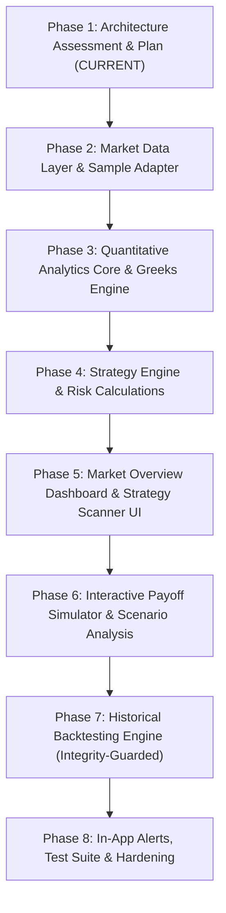

# Implementation Assessment: Options Strategy Intelligence & Analytics Platform

> **Document Status**: Complete (Phase 1 Initial Assessment)  
> **Repository**: `MarketAnalysis`  
> **Date**: 2026-11-04  
> **Author**: Antigravity Quantitative Systems Architecture Team  
> **Mandate**: Informational analytical terminal enhancement. Strict adherence to non-disruptive, modular extension of existing architecture. No unauthorized scraping; strict `data_mode` isolation (`LIVE` | `HISTORICAL` | `SAMPLE`).

---

## 1. Executive Summary & Project Objective

The objective of this project is to enhance the existing NSE Option Chain and Analytics Terminal by integrating an institutional-grade **Options Strategy Intelligence & Analytics Module**. 

### Critical Architecture Directives
1. **Preserve & Extend — Never Replace**: The existing application must not be replaced, rewritten, or encapsulated into an alien framework. It currently operates with high performance, zero frontend npm build bloat, and minimal server overhead. The new capabilities must seamlessly plug into the current UI, backend server, database, and design system.
2. **Informational Terminal Disclaimer**: Every analytical output, strategy evaluation, Greeks metric, and payoff curve must be explicitly labeled as informational. Under SEBI regulations and algorithmic disclosure rules, the system will never present calculated indicators as guaranteed predictions, automated order execution, or financial/trading advice.
3. **Data Compliance & Separation**: The NSE public website is utilized solely as a UX/field layout reference. Real-time production ingestion is strictly decoupled into a provider-independent ingestion interface. Every API payload, UI element, and database record will explicitly state its data provenance via `data_mode: LIVE | HISTORICAL | SAMPLE`.

---

## 2. Current Architecture Assessment

### 2.1 Backend Framework & Server Architecture
* **Server Implementation**: Standard library Python `http.server.ThreadingHTTPServer` paired with a custom `BaseHTTPRequestHandler` subclass (`OptionChainHandler` in [`server.py`](file:///e:/Work/MarketAnalysis/server.py)).
* **HTTP Protocol**: HTTP/1.1 with persistent TCP connections (Keep-Alive), CORS preflight negotiation (`do_OPTIONS`), and non-blocking exception handling in `do_GET`.
* **State & Concurrency**:
  - In-memory thread-safe LRU Cache with `OrderedDict` and `threading.Lock()`, caching symbol responses with a 30-second TTL.
  - Multi-threaded request dispatch with thread-safe session initialization using `threading.RLock()` in [`core/session.py`](file:///e:/Work/MarketAnalysis/core/session.py).
  - Singletons for [`NSEOptionChainCrawler`](file:///e:/Work/MarketAnalysis/core/crawler.py) and [`StorageHandler`](file:///e:/Work/MarketAnalysis/storage/handler.py).
* **Current API Endpoints**:
  - `GET /` & `GET /ui/*`: Static file router serving raw HTML, CSS, and JS assets.
  - `GET /api/option-chain?symbol=...&equity=true|false&expiry=...`: Main option chain payload with calculated ATM, Max Pain, PCR, and Cash Equity fallback.
  - `GET /api/snapshots?symbol=...`: Historical snapshot queries from SQLite.
  - `GET /api/market-status`: Live NSE operational market status (`Capital Market`, `Currency`, `Derivatives`).
  - `GET /api/export?symbol=...&format=csv|parquet|json&expiry=...&equity=...`: One-click raw dataset export.
  - `GET /favicon.ico`: HTTP 204 No Content.

### 2.2 Frontend Framework & Architecture
* **Stack**: Native Vanilla JavaScript (ES6+), HTML5 semantic markup, and CSS3 custom properties. Zero bundling step, zero Node.js/npm dependencies, zero framework runtime overhead.
* **Component Model**: Functional DOM manipulation, state-driven rendering with an in-memory `state` object in [`ui/js/app.js`](file:///e:/Work/MarketAnalysis/ui/js/app.js), and event-driven delegation.
* **Charting Engine**: Global Chart.js (v4.4.1 CDN). Configured with canvas renders for:
  - Strike-wise Open Interest (Grouped Bar Chart)
  - Intraday Change in OI (Buildup & Unwinding Bar Chart)
  - Max Pain Cumulative Payout Liability Curve (Spline Line Chart with ATM/Valley markers)
  - Implied Volatility (IV) Smile & Skew Curve (Dual Spline Line Chart with `spanGaps: true`)
* **Styling & Design System**:
  - Typography: Google Fonts `Outfit` (clean geometric sans-serif for UI elements) and `JetBrains Mono` (high-legibility monospaced for numeric matrices, strikes, and monetary figures).
  - Multi-Theme Engine: CSS custom property tokens defined in [`ui/css/styles.css`](file:///e:/Work/MarketAnalysis/ui/css/styles.css) with live switcher (`#theme-select`):
    - `pastel-light` (default): Crisp porcelain background (`#f6f8fd`), pure white surface cards (`#ffffff`), soft pastel mint calls (`#059669`, `#7dd3fc`), blush/coral puts (`#e11d48`, `#fda4af`), amber accents (`#d97706`), slate typography (`#1e293b`).
    - `pastel-dark`: Twilight slate background (`#151722`), velvet card containers (`#1c1f2e`), pastel luminous highlights.
    - `dark` (Classic Dark): Obsidian background (`#07090e`), slate-900 surfaces (`#0f1422`), electric cyan and crimson accents.
  - Reusable Components: Metric cards (`.metric-card`), ratio progress bars (`.ratio-bar-container`), range pills (`.range-pill`), symbol pills (`.symbol-pill`), toast notifications (`.toast-container`), loading overlay backdrop (`.loading-overlay`).
  - Responsive Breakpoints: 1200px, 992px, 768px, 640px, 480px.

### 2.3 Database & Storage Architecture
* **Database Engine**: Local SQLite 3 (`data/market_analysis.db`).
* **Concurrency Configuration**:
  - Write-Ahead Logging enabled (`PRAGMA journal_mode=WAL;`).
  - Busy timeout set to 15.0s (`sqlite3.connect(..., timeout=15.0)`).
  - Performance indexing on `market_snapshots(symbol, recorded_at)`.
* **Existing Relational Schema**:
  1. `market_snapshots`: Executive metrics per symbol per timestamp (underlying price, ATM, Max Pain, PCR OI, PCR Volume, Total Strikes).
  2. `option_chain`: Merged CE/PE strike matrix records per snapshot time.
  3. `option_calls`: Granular Call leg records.
  4. `option_puts`: Granular Put leg records.
  5. `option_futures`: Underlying futures contracts.
* **Cold Storage**: Automatic export to CSV (`data/csv/`), Apache Parquet (`data/parquet/` via `pyarrow`), and Raw JSON (`data/raw/`).

### 2.4 Ingestion & Current Market Data Integration
* **Current Implementation**: Direct HTTP session automation via [`core/crawler.py`](file:///e:/Work/MarketAnalysis/core/crawler.py) and [`core/session.py`](file:///e:/Work/MarketAnalysis/core/session.py). Uses Akamai perimeter cookie harvesting (`_abck`, `nsit`), header rotation, and exponential jittered backoff.
* **NSE Endpoints Utilized**:
  - NextApi `GetQuoteApi?functionName=getSymbolData` (Primary)
  - `option-chain-indices` & `option-chain-equities` (Fallback)
  - `quote-equity` (Cash Equity quote fallback for non-F&O stocks like `JPL`)
  - `marketStatus` (Live market hours & exchange status)
* **Compliance Reality**: Direct public web harvesting is prone to perimeter bot-block changes, CAPTCHA challenges, and IP throttling. It serves as a field/UX benchmark and fallback, but cannot satisfy enterprise SLA or licensed data distribution.

---

## 3. Existing UI Integration Points & Component Reuse Plan

To ensure the new Options Strategy Intelligence Module feels like an organic, first-class citizen of the existing terminal, the following integration anchors will be utilized:

```
Existing Top Navbar (Brand, Symbol Pills, Search Input, Market Status, Theme Switcher, Auto-Refresh)
│
├── Top Level Section Navigation (NEW TABS / SUB-NAV):
│   ├── [1] Option Chain Terminal (Current View Preserved Intact)
│   └── [2] Options Intelligence (NEW EXTENSION)
│       ├── Sub-Tab: Market Overview (Dashboard)
│       ├── Sub-Tab: Interactive Option Chain (Advanced Analytics)
│       ├── Sub-Tab: Strategy Scanner (Regime & Signal Matrix)
│       ├── Sub-Tab: Strategy Analysis & Payoff Simulator (Interactive Builder)
│       ├── Sub-Tab: Historical Backtesting (Integrity-Checked Engine)
│       ├── Sub-Tab: Performance Analytics (Reporting & Drawdowns)
│       ├── Sub-Tab: Alerts & Notifications (Threshold Triggers)
│       └── Sub-Tab: Strategy Configuration (Rule Registry & Admin)
│
├── Shared Executive Metric Grid (.metrics-grid)
│   (Reused with dynamic context: Option Chain metrics OR Strategy Portfolio metrics)
│
├── Shared Design System Tokens (.css custom properties)
│   (Zero color mismatches; all new screens natively inherit Pastel Day, Pastel Dusk, Classic Dark)
│
└── Shared Feedback Systems
    (Toast notifications via #toast-container, Global Loading Overlay via #loading-overlay)
```

### Reusable UI Components
1. **`.metrics-grid` & `.metric-card`**: Reuse for strategy metrics (Net Debit/Credit, Max Profit, Max Loss, Breakeven, Reward/Risk, Margin).
2. **`.select-dropdown` & `.symbol-pill`**: Reuse for strategy category filtering (Bullish, Bearish, Neutral, Volatility), underlying selection, and expiry selection.
3. **`.option-table`**: Standard table styles with sorting, sticky headers, and ITM/ATM highlight classes.
4. **`.chart-card` & `.chart-canvas-wrapper`**: Container elements for new Canvas charts (Payoff curve, Scenario matrix, PnL distribution).
5. **Chart.js Configuration**: Theme-adaptive options factory `getThemeColors()` and `getChartOptions()` extended with dashed lines, fill zones, and breakeven vertical annotations.

---

## 4. Recommended Implementation Architecture

The architecture follows a clean, decoupled 5-tier pipeline:

```
┌────────────────────────────────────────────────────────────────────────┐
│                   Tier 1: Market Data Ingestion                        │
│  ┌───────────────────────┐  ┌────────────────────┐  ┌───────────────┐  │
│  │ Licensed Provider API │  │ Sample Data Engine │  │ Reference NSE │  │
│  │ (Broker / Vendor Feed)│  │ (Deterministic Mock│  │ Web Ingestion │  │
│  │ (Kite/Upstox/TrueData)│  │ for Offline/Test)  │  │ (Fallback)    │  │
│  └───────────┬───────────┘  └─────────┬──────────┘  └───────┬───────┘  │
└──────────────┼────────────────────────┼─────────────────────┼──────────┘
               ▼                        ▼                     ▼
┌────────────────────────────────────────────────────────────────────────┐
│                   Tier 2: Ingestion & Normalization                    │
│  - Provider-Independent Ingestion Interface (MarketDataProvider ABC)   │
│  - Contract Master & Symbol Normalizer (NIFTY, BANKNIFTY, Equities)    │
│  - Data Validation, Stale-Data Detection, Data Freshness Watchdog      │
│  - Explicit Data Mode Tagging: data_mode: LIVE | HISTORICAL | SAMPLE   │
└───────────────────────────────────┬────────────────────────────────────┘
                                    ▼
┌────────────────────────────────────────────────────────────────────────┐
│                   Tier 3: Quantitative Analytics Core                  │
│  ┌──────────────────────┐ ┌───────────────────┐ ┌───────────────────┐  │
│  │ Derived Indicators   │ │ Black-Scholes     │ │ Market Regime     │  │
│  │ - Strike-wise OI/Vol │ │ Greeks Engine     │ │ Classifier        │  │
│  │ - PCR (OI & Vol)     │ │ - Delta, Gamma,   │ │ - Bullish, Bearish│  │
│  │ - Max Pain & Skew    │ │   Theta, Vega, Rho│ │ - Range-Bound,    │  │
│  │ - IV Percentile/ATM  │ │ - IV Root Finder  │ │   High Volatility │  │
│  └──────────┬───────────┘ └─────────┬─────────┘ └─────────┬─────────┘  │
└─────────────┼───────────────────────┼─────────────────────┼────────────┘
              ▼                       ▼                     ▼
┌────────────────────────────────────────────────────────────────────────┐
│              Tier 4: Strategy & Risk Intelligence Engine               │
│  ┌────────────────────────┐  ┌───────────────────┐  ┌───────────────┐  │
│  │ Strategy Registry      │  │ Risk & Payoff     │  │ Historical    │  │
│  │ - 16 Classical Strategy│  │ Calculator        │  │ Backtesting   │  │
│  │   Definitions          │  │ - Expiry Payoff   │  │ Engine        │  │
│  │ - Entry/Exit Rules     │  │ - Pre-Expiry PnL  │  │ - Point-in-   │  │
│  │ - Strike/Expiry Filter │  │ - Scenario Matrix │  │   Time Data   │  │
│  │ - Rule Evaluation &    │  │ - Margin & Cost   │  │ - No Lookahead│  │
│  │   Explainable Score    │  │   Slippage Engine │  │ - Metric Report│ │
│  └──────────┬─────────────┘  └─────────┬─────────┘  └───────┬───────┘  │
└─────────────┼──────────────────────────┼────────────────────┼──────────┘
              ▼                          ▼                    ▼
┌────────────────────────────────────────────────────────────────────────┐
│                   Tier 5: Presentation & API Layer                     │
│  - REST API Routing (Modular Handlers extending server.py)             │
│  - High-Performance SQLite Snapshot Storage (WAL Mode)                 │
│  - Frontend UI Modules (Vanilla ES6, Chart.js, Multi-Theme System)     │
└────────────────────────────────────────────────────────────────────────┘
```

---

## 5. Files and Components Requiring Modification vs. New Modules

### 5.1 Existing Files Requiring Modification (Non-Disruptive Extension)
| File | Planned Modifications |
| :--- | :--- |
| [`server.py`](file:///e:/Work/MarketAnalysis/server.py) | Register new REST API endpoints under `/api/options/*` with modular router dispatch; preserve all existing `/api/option-chain`, `/api/snapshots`, and `/api/export` routes without alteration. |
| [`config/settings.py`](file:///e:/Work/MarketAnalysis/config/settings.py) | Add configuration schema for active data providers (`active_provider: sample | nse_direct | broker`), strategy thresholds, transaction cost defaults, and risk bounds. |
| [`ui/index.html`](file:///e:/Work/MarketAnalysis/ui/index.html) | Add top-level sub-navigation tab bar for "Option Chain Terminal" vs. "Options Intelligence", insert modular section containers for the 9 intelligence subsections, and link new modular scripts. |
| [`ui/css/styles.css`](file:///e:/Work/MarketAnalysis/ui/css/styles.css) | Add styling tokens for Strategy Scanner cards, Payoff builder controls, scenario heatmaps, and backtest equity curves while keeping existing styles untouched. |
| [`ui/js/app.js`](file:///e:/Work/MarketAnalysis/ui/js/app.js) | Maintain existing option chain matrix and chart logic; hook into shared state and register tab switching delegation for new modules. |
| [`storage/handler.py`](file:///e:/Work/MarketAnalysis/storage/handler.py) | Extend SQLite migration routines to create tables for underlying master, contract master, strategy definitions, evaluations, and alerts. |
| [`CHANGELOG.md`](file:///e:/Work/MarketAnalysis/CHANGELOG.md) | Record each phase modification in accordance with repo commit-wise changelog rules. |

### 5.2 New Modules & Files Required
```
MarketAnalysis/
├── core/
│   ├── providers/
│   │   ├── __init__.py
│   │   ├── base.py                   # MarketDataProvider abstract base class
│   │   ├── sample_provider.py        # Deterministic offline sample data generator
│   │   ├── nse_provider.py           # Existing crawler wrapped in provider interface
│   │   └── broker_provider.py        # Generic licensed broker/vendor adapter template
│   └── normalization.py              # Ingestion validation, contract master & data_mode tagger
│
├── analytics/
│   ├── __init__.py
│   ├── greeks.py                     # Black-Scholes pricing, Greeks (Delta, Gamma, Theta, Vega, Rho) & IV solver
│   ├── indicators.py                 # Derived indicators (PCR, OI concentrations, ATM identification, IV skew)
│   ├── regime.py                     # Market regime classifier (Bullish, Bearish, Range-bound, Volatile)
│   └── liquidity.py                  # Bid-Ask spread & strike liquidity scoring
│
├── strategies/
│   ├── __init__.py
│   ├── definitions.py                # Formal specifications for 16 classical strategies
│   ├── registry.py                   # Strategy catalog, rule definitions & configurable parameters
│   ├── legs.py                       # Option leg builder & strike selection logic
│   ├── evaluator.py                  # Evaluation pipeline with explainable passed/failed conditions
│   └── scanner.py                    # Multi-strike / multi-symbol strategy scanner engine
│
├── risk/
│   ├── __init__.py
│   ├── payoff.py                     # Dynamic expiry payoff calculator & breakeven solver
│   ├── scenarios.py                  # Multi-variable scenario simulation (Underlying vs. IV vs. DTE)
│   ├── margin.py                     # Exchange span/exposure approximation estimator
│   └── costs.py                      # Configurable Indian brokerage, STT, GST, and slippage model
│
├── backtest/
│   ├── __init__.py
│   ├── engine.py                     # Point-in-time walk-forward backtesting simulator
│   ├── metrics.py                    # Performance analytics (Win Rate, Profit Factor, Max Drawdown, Sharpe)
│   └── validator.py                  # Data integrity auditor (prevents lookahead & survivorship bias)
│
├── alerts/
│   ├── __init__.py
│   ├── manager.py                    # In-app alert rule registry & event emitter
│   └── evaluator.py                  # Threshold evaluation against incoming market snapshots
│
├── api/
│   ├── __init__.py
│   ├── router.py                     # Clean endpoint dispatcher plugged into server.py
│   └── schemas.py                    # JSON request/response schema validators
│
├── ui/js/modules/
│   ├── market_overview.js            # Dashboard rendering & regime display
│   ├── strategy_scanner.js           # Strategy card grid, filtering & rule explanation modal
│   ├── payoff_simulator.js           # Interactive leg builder, drag-and-drop & Chart.js payoff spline
│   ├── backtesting.js                # Backtest runner, equity curve & trade log viewer
│   ├── alerts_ui.js                  # Alerts configuration drawer & toast stream
│   └── strategy_config_ui.js         # Strategy parameter editor & rule customizer
│
└── tests/
    ├── test_providers.py             # Provider interface and sample generator tests
    ├── test_greeks.py                # Mathematical precision tests for Black-Scholes & Greeks
    ├── test_indicators.py            # Comprehensive derived indicator unit tests
    ├── test_strategies.py            # Strategy evaluation, leg construction & scoring tests
    ├── test_risk_payoff.py           # Payoff, breakeven, and scenario calculation tests
    ├── test_backtest.py              # Historical backtesting simulation & bias prevention tests
    └── test_api_options.py           # REST API endpoint integration tests
```

---

## 6. Database Migration Requirements

To store contract specifications, derived indicators, strategy evaluations, and backtest results without breaking existing tables, the following relational schema migrations will be applied in SQLite (`data/market_analysis.db`):

```sql
-- 1. Underlying Asset Master
CREATE TABLE IF NOT EXISTS underlying_master (
    symbol TEXT PRIMARY KEY,
    name TEXT NOT NULL,
    asset_type TEXT NOT NULL, -- INDEX, EQUITY
    lot_size INTEGER NOT NULL,
    tick_size REAL DEFAULT 0.05,
    strike_step REAL NOT NULL,
    is_active INTEGER DEFAULT 1,
    created_at TEXT NOT NULL
);

-- 2. Option Contract Master
CREATE TABLE IF NOT EXISTS contract_master (
    contract_id TEXT PRIMARY KEY, -- e.g. NIFTY26NOV23000CE
    symbol TEXT NOT NULL,
    expiry_date TEXT NOT NULL,
    strike_price REAL NOT NULL,
    option_type TEXT NOT NULL, -- CE, PE
    lot_size INTEGER NOT NULL,
    is_active INTEGER DEFAULT 1,
    FOREIGN KEY(symbol) REFERENCES underlying_master(symbol)
);

-- 3. Normalized Option Chain Snapshots with Data Mode
CREATE TABLE IF NOT EXISTS option_chain_snapshots (
    snapshot_id TEXT PRIMARY KEY,
    symbol TEXT NOT NULL,
    timestamp TEXT NOT NULL,
    recorded_at TEXT NOT NULL,
    underlying_value REAL NOT NULL,
    data_mode TEXT NOT NULL CHECK(data_mode IN ('LIVE', 'HISTORICAL', 'SAMPLE')),
    data_source TEXT NOT NULL,
    data_quality_status TEXT NOT NULL,
    raw_payload_ref TEXT
);

-- 4. Derived Quantitative Indicators
CREATE TABLE IF NOT EXISTS derived_indicators (
    indicator_id TEXT PRIMARY KEY,
    snapshot_id TEXT NOT NULL,
    symbol TEXT NOT NULL,
    timestamp TEXT NOT NULL,
    formula_version TEXT NOT NULL,
    atm_strike REAL NOT NULL,
    max_pain_strike REAL,
    pcr_oi REAL,
    pcr_volume REAL,
    highest_call_oi_strike REAL,
    highest_put_oi_strike REAL,
    atm_iv REAL,
    iv_percentile REAL,
    market_regime TEXT,
    FOREIGN KEY(snapshot_id) REFERENCES option_chain_snapshots(snapshot_id)
);

-- 5. Strategy Definitions Catalog
CREATE TABLE IF NOT EXISTS strategy_definitions (
    strategy_id TEXT PRIMARY KEY,
    name TEXT NOT NULL,
    category TEXT NOT NULL CHECK(category IN ('BULLISH', 'BEARISH', 'NEUTRAL', 'VOLATILITY')),
    market_direction TEXT NOT NULL,
    description TEXT,
    is_custom INTEGER DEFAULT 0,
    is_enabled INTEGER DEFAULT 1,
    config_json TEXT NOT NULL,
    updated_at TEXT NOT NULL
);

-- 6. Strategy Evaluation Logs
CREATE TABLE IF NOT EXISTS strategy_evaluations (
    evaluation_id TEXT PRIMARY KEY,
    strategy_id TEXT NOT NULL,
    snapshot_id TEXT NOT NULL,
    symbol TEXT NOT NULL,
    expiry TEXT NOT NULL,
    status TEXT NOT NULL CHECK(status IN ('QUALIFIED', 'WATCHLIST', 'REJECTED')),
    confidence_score REAL NOT NULL,
    net_debit_credit REAL NOT NULL,
    max_profit REAL,
    max_loss REAL,
    breakeven_points TEXT, -- JSON array
    reward_to_risk REAL,
    margin_estimate REAL,
    passed_rules TEXT, -- JSON array
    failed_rules TEXT, -- JSON array
    evaluated_at TEXT NOT NULL,
    FOREIGN KEY(strategy_id) REFERENCES strategy_definitions(strategy_id),
    FOREIGN KEY(snapshot_id) REFERENCES option_chain_snapshots(snapshot_id)
);

-- 7. Backtest Runs & Performance
CREATE TABLE IF NOT EXISTS backtest_results (
    backtest_id TEXT PRIMARY KEY,
    strategy_id TEXT NOT NULL,
    symbol TEXT NOT NULL,
    start_date TEXT NOT NULL,
    end_date TEXT NOT NULL,
    total_trades INTEGER NOT NULL,
    win_rate REAL NOT NULL,
    loss_rate REAL NOT NULL,
    profit_factor REAL,
    max_drawdown REAL NOT NULL,
    net_pnl REAL NOT NULL,
    sharpe_ratio REAL,
    run_timestamp TEXT NOT NULL,
    metrics_json TEXT NOT NULL,
    trades_json TEXT NOT NULL
);

-- 8. Configurable Alerts
CREATE TABLE IF NOT EXISTS user_alerts (
    alert_id TEXT PRIMARY KEY,
    symbol TEXT NOT NULL,
    alert_type TEXT NOT NULL, -- PCR_THRESHOLD, IV_SPIKE, OI_CHANGE, STRATEGY_QUALIFIED
    conditions_json TEXT NOT NULL,
    is_active INTEGER DEFAULT 1,
    created_at TEXT NOT NULL,
    last_triggered_at TEXT
);

-- Indexes for lightning queries
CREATE INDEX IF NOT EXISTS idx_snapshots_sym_mode ON option_chain_snapshots(symbol, data_mode, recorded_at);
CREATE INDEX IF NOT EXISTS idx_indicators_snap ON derived_indicators(snapshot_id);
CREATE INDEX IF NOT EXISTS idx_evaluations_strat ON strategy_evaluations(strategy_id, symbol, evaluated_at);
```

---

## 7. Market Data Integration & Compliance Strategy

### 7.1 Provider-Independent Data Interface
A generic abstract base class [`MarketDataProvider`](file:///e:/Work/MarketAnalysis/core/providers/base.py) will define the standard contract:
* `get_underlying_quote(symbol: str) -> UnderlyingQuote`
* `get_option_chain(symbol: str, expiry: Optional[str]) -> NormalizedOptionChain`
* `get_expiries(symbol: str) -> List[str]`
* `get_historical_chain(symbol: str, date: str) -> Optional[NormalizedOptionChain]`
* `get_provider_health() -> ProviderHealthStatus`

### 7.2 Strict Data Mode Tagging
Every response model and UI element will be stamped with `data_mode`:
* **`LIVE`**: Originating from an authorized, authenticated market-data vendor or broker API with valid entitlements.
* **`HISTORICAL`**: Point-in-time historical records from verified cold storage.
* **`SAMPLE`**: Deterministically generated synthetic option chain with realistic strikes, Black-Scholes pricing, and volume distribution used solely for UI preview, offline development, and unit test verification.
* **Rule**: Sample data will feature a conspicuous top warning pill: `⚠️ SAMPLE DATA MODE (NOT LIVE MARKET FEED)`.

### 7.3 Data-Provider Onboarding Checklist
To onboard a commercial broker or market-data feed (e.g. Zerodha Kite, Upstox, Dhan, Fyers, TrueData), the product owner will provide configuration via `.env` (never hardcoded in source):
```env
OPTIONS_DATA_PROVIDER=sample          # sample | nse_direct | broker_kite | broker_upstox
BROKER_API_KEY=                        # Vault/Secret reference only
BROKER_API_SECRET=                     # Never checked into Git
BROKER_RATE_LIMIT_RPS=3                # Configured per broker SLA
BROKER_PERMITTED_SYMBOLS=NIFTY,BANKNIFTY,FINNIFTY,MIDCPNIFTY
BROKER_HISTORICAL_ENTITLED=false       # Enables or disables backtesting tab
```

---

## 8. Strategy Engine & Mathematical Specifications

### 8.1 16 Classical Options Strategies
The strategy engine will implement formal leg definitions, strike selection heuristics, and payoff mathematics for 4 standard market categories:

| Category | Strategy Name | Legs Definition | Strike Heuristic | Typical Market Regime |
| :--- | :--- | :--- | :--- | :--- |
| **Bullish** | **Long Call** | +1 Call | ATM or slight OTM (0-1% OTM) | Strong Bullish Breakout, High IV expansion expected |
| | **Bull Call Spread** | +1 Call (Lower Strike), -1 Call (Higher Strike) | Buy ATM, Sell 1-2% OTM | Moderate Bullish, IV stable/moderate |
| | **Bull Put Spread** | +1 Put (Lower Strike), -1 Put (Higher Strike) | Sell ATM/slight OTM, Buy further OTM | Mild Bullish / Range Support, High IV (Credit) |
| | **Call Ratio Spread** | +1 Call (Lower Strike), -2 Call (Higher Strike) | Buy ATM, Sell 2x OTM | Mild Bullish with upside resistance cap |
| **Bearish** | **Long Put** | +1 Put | ATM or slight OTM (0-1% OTM) | Strong Bearish Breakdown, High IV expansion |
| | **Bear Put Spread** | +1 Put (Higher Strike), -1 Put (Lower Strike) | Buy ATM, Sell 1-2% OTM | Moderate Bearish, IV stable/moderate |
| | **Bear Call Spread** | +1 Call (Higher Strike), -1 Call (Lower Strike) | Sell ATM/slight OTM, Buy further OTM | Mild Bearish / Range Resistance, High IV (Credit) |
| | **Put Ratio Spread** | +1 Put (Higher Strike), -2 Put (Lower Strike) | Buy ATM, Sell 2x OTM | Mild Bearish with downside support cushion |
| **Neutral** | **Iron Condor** | +1 Put (OTM2), -1 Put (OTM1), -1 Call (OTM1), +1 Call (OTM2) | Sells outside expected 1σ move, buys wings | Low Volatility, Sideways Consolidation, Range-Bound |
| | **Iron Butterfly** | +1 Put (OTM), -1 Put (ATM), -1 Call (ATM), +1 Call (OTM) | Sells ATM straddle, buys protective wings | Low Volatility, Pin at Strike expected |
| | **Short Straddle** | -1 Call (ATM), -1 Put (ATM) | Sells exact ATM strike | Range pin, Rapid Theta decay, IV crush expected |
| | **Short Strangle** | -1 Put (OTM), -1 Call (OTM) | Sells 1-2 standard deviation strikes | Range-Bound between key support & resistance |
| **Volatility**| **Long Straddle** | +1 Call (ATM), +1 Put (ATM) | Buys exact ATM strike | Major Event / Earnings / Election, Big move expected |
| | **Long Strangle** | +1 Put (OTM), +1 Call (OTM) | Buys equidistant OTM strikes | Lower cost volatility breakout play |
| | **Calendar Spread** | -1 Call (Near Expiry), +1 Call (Far Expiry) | Same strike (ATM or slight OTM) | Neutral near term, Theta decay advantage |
| | **Diagonal Spread** | -1 Call (Near Expiry, Higher Strike), +1 Call (Far Expiry, Lower Strike) | Skewed strike & expiry configuration | Directional bias with longer-term horizon |

### 8.2 Evaluation Pipeline & Explainable Scoring
Each strategy is scored on a deterministic **0 to 100 Confidence Index**:
* **Directional Alignment (30 pts)**: Underlying spot price trend, PCR ratio slope, and moving average momentum.
* **Volatility Regime (25 pts)**: IV Percentile (IVP). Debit spreads favor low IVP (<40); credit spreads favor high IVP (>60).
* **Open Interest & Concentration Support (20 pts)**: Alignment with Max Pain magnet and major Call/Put OI barriers.
* **Risk/Reward & Margin Quality (15 pts)**: Minimum reward-to-risk threshold (e.g. >= 1.5 for debits, acceptable win probability for credits).
* **Liquidity & Spread Safety (10 pts)**: Bid-ask spread narrowness across all candidate legs.

---

## 9. Risk Management, Greeks & Cost Model

### 9.1 Black-Scholes Formula & Greeks
* **Pricing Model**: Black-Scholes-Merton (1973) continuous model with dividend yield adaptation for Indian index derivatives ($q \approx 1.2\%$).
* **Greeks Evaluated**:
  - **Delta ($\Delta$)**: Directional sensitivity per 1 point underlying move.
  - **Gamma ($\Gamma$)**: Curvature/acceleration of Delta per point move.
  - **Theta ($\Theta$)**: Daily time decay loss/gain in INR.
  - **Vega ($\nu$)**: Portfolio sensitivity to a 1% shift in Implied Volatility.
  - **Rho ($\rho$)**: Interest rate sensitivity (using RBI Repo benchmark $\approx 6.5\%$).
* **IV Calculation**: Vectorized Brent-Decker or Newton-Raphson root finder with fallback guards against deep OTM anomalies.

### 9.2 Transaction Cost & Slippage Engine
Indian options trading carries material friction that frequently turns theoretical profits negative. The risk engine will calculate all metrics:
1. **Gross Theoretical Payoff**
2. **Net Realizable Payoff (Post-Friction)**
* **Configurable Cost Parameters**:
  - Brokerage: Default ₹20 per executed order.
  - Securities Transaction Tax (STT): 0.1% on sell-side option premium (or exercise value).
  - Exchange Turnover Charges: 0.05% on premium turnover.
  - GST: 18% on (Brokerage + Exchange Charges).
  - Stamp Duty: 0.003% on buy-side gross.
  - Slippage Assumption: Configurable 0.25% to 1.0% on market leg fills.

---

## 10. Development Sequence & Dependency Graph



---

## 11. Risks, Unresolved Assumptions & Mitigation Matrix

| # | Risk / Assumption | Impact | Mitigation Strategy |
| :--- | :--- | :--- | :--- |
| **R1** | **NSE Perimeter Throttling** | High | Abstract all data access behind `MarketDataProvider`. Provide a full-featured `SampleDataProvider` for all dev/UI work. Never rely on unauthorized scraping in production. |
| **R2** | **Absence of Licensed Historical Tick Data** | High | If historical tick or 1-minute chain data is absent, the Backtesting engine will be safely placed in `DATA_UNAVAILABLE` status with a clear informational prompt rather than fabricating synthetic historical curves. |
| **R3** | **Black-Scholes American Option Discrepancy** | Low | Indian index options (`NIFTY`, `BANKNIFTY`) are European style (`CE`/`PE`), strictly fitting Black-Scholes. Stock options are American; for stock options, Bjerksund-Stensland approximation will be applied if early exercise risk is non-negligible. |
| **R4** | **Browser Memory Bloat on Live Feeds** | Medium | Cap UI table DOM nodes to selected strike range ($\pm 15$ strikes). Use Chart.js canvas recycling (`chart.destroy()`) before re-instantiation. |
| **R5** | **Margin Calculation Accuracy** | Medium | NSE SPAN and Exposure margins require real-time risk files from NSCCL. The terminal will clearly label all margins as `Estimated Approximation` unless hooked into an active broker margin API. |

---

## 12. Required User Decisions Before Phase 2

Before commencing implementation of Phase 2, the following configuration decisions require user approval:

1. **Default Data Mode for Phase 2**: Shall we implement the `SampleDataProvider` first to power all strategy evaluation, payoff calculations, and UI testing completely offline without network flakiness?
2. **Strategy Catalog Scope**: Is the 16-strategy catalog (Bullish, Bearish, Neutral, Volatility) approved as the baseline, with custom strategy definition support?
3. **UI Navigation Form Factor**: Do you prefer the new Options Intelligence module to be accessed via a top-level navbar tab toggle (`[Option Chain Terminal] | [Options Intelligence]`) or a left collapsible financial terminal sidebar? (Recommended: Top-level sub-nav tab toggle to preserve the existing clean layout).

---
*Assessment concluded. Please refer to [`IMPLEMENTATION_PLAN.md`](file:///e:/Work/MarketAnalysis/IMPLEMENTATION_PLAN.md) for the phase-by-phase execution plan.*

