# 01 — System Architecture & Infrastructure Blueprint

- **Last-Analyzed Commit**: `8ff63675b59f0f5c1cd3d4bdcb3f8d74229ef6a5`
- **Audience**: Enterprise Architects, DevOps/SRE, Tech Leads
- **Prerequisites**: Familiarity with Docker Compose networking, C4 Model, and Microservice / Modular Monolith principles

> [!NOTE]
> **Assumptions & Open Questions**
> - **Assumption**: Single-node container orchestration via Docker Compose is currently sufficient for local workstation and single-VM hosting; multi-node clustering requires migration to Kubernetes.
> - **Open Question**: Should PySpark distributed workers be retained for batch operations, or replaced with Polars/DuckDB within the consumer container to reduce resource overhead?

---

## Table of Contents
1. [Architectural Style & Design Principles](#1-architectural-style--design-principles)
2. [C4 Container Architecture Diagram](#2-c4-container-architecture-diagram)
3. [Container & Service Topology Matrix](#3-container--service-topology-matrix)
4. [Process Entry Points & Lifecycles](#4-process-entry-points--lifecycles)
5. [Configuration Hierarchy & Secrets Surface](#5-configuration-hierarchy--secrets-surface)
6. [Change Log](#6-change-log)

---

## 1. Architectural Style & Design Principles

The platform follows a **Clean Architecture Modular Monolith** pattern paired with an **Event-Driven Asynchronous Data Lakehouse**:

```
[ Ingestion / Scrapers ] ──( Redis Stream )──> [ Orchestration / Prefect ]
                                                        │
         ┌─────────────────── Clean Architecture Kernel ┴──────────────────┐
         │                                                                 │
         │   [ Ports / Protocols ] <──> [ Core Services ] <──> [ Domain ]   │
         │   (LLM, VectorStore)         (Skill, Title, Salary) (Job, Salary)│
         │                                                                 │
         └──────────────────────────────────┬──────────────────────────────┘
                                            │
                       ┌────────────────────┼────────────────────┐
                       ▼                    ▼                    ▼
             [ PostgreSQL / pgvector ] [ Elasticsearch ]   [ MinIO S3 ]
                       │                    │
                       └──────────┬─────────┘
                                  ▼
                        [ FastAPI Serving API ]
```

### Key Architectural Tenets:
1. **Dependency Inversion (DIP)**: Core business rules ([core/domain/](file:///d:/job_se/core/domain/)) and deterministic services ([core/services/](file:///d:/job_se/core/services/)) import zero database, web, or framework packages. They communicate across abstract protocol interfaces ([core/ports/](file:///d:/job_se/core/ports/)).
2. **Buffer-First Ingestion**: Crawlers do not write directly to databases. All scraped items pass through a Dragonfly Redis Stream buffer (`raw-jobs`), decoupling external web crawler rates from database write capacity.
3. **Multi-Model Storage (Polyglot Persistence)**:
   - **PostgreSQL 16**: Relational master data, transactional state, and HNSW cosine vector index for semantic search.
   - **Elasticsearch 8.13**: Inverted index optimized for lexical BM25 keyword matching and full-text ranking.
   - **MinIO S3**: Immutable cold storage archiving original JSON payloads for disaster recovery and compliance auditability.

---

## 2. C4 Container Architecture Diagram

```mermaid
C4Container
    title Container Diagram for Remote 150K+ Job Search Platform

    Person(candidate, "Candidate / Job Seeker", "Discovers verified $150K+ remote AI/ML roles via web.")
    Person(operator, "Data / Platform Engineer", "Monitors stream backpressure, spider health, and pipeline execution.")

    System_Boundary(c1, "Platform Infrastructure (Docker Compose)") {
        Container(api, "FastAPI Serving API", "Python 3.11, Uvicorn", "Serves /jobs, /search (hybrid RRF), and Prometheus /metrics.", "Port 8000")
        Container(scheduler, "Prefect Scheduler", "Python 3.12, Prefect 3.2", "Runs in-process serve loop for 5 scheduled flows.", "Internal")
        Container(prefect_server, "Prefect Server & UI", "Python 3.12", "Orchestration API, UI dashboard, and flow telemetry.", "Port 4200")
        Container(scraper, "Scraper Daemon", "Python 3.11, Scrapy", "Scrapy runtime container executing 14 portal spiders.", "Internal")

        ContainerDb(dragonfly, "Dragonfly (Redis Drop-in)", "Dragonfly v2.0", "Redis Streams: raw-jobs (inbound) and raw-jobs-dlq (dead-letter).", "Port 6380")
        ContainerDb(postgres, "PostgreSQL 16 + pgvector", "pgvector/pgvector:pg16", "Relational master tables and 1536-dim HNSW vector index.", "Port 5432")
        ContainerDb(elasticsearch, "Elasticsearch 8.13", "Elasticsearch 8.13.4", "BM25 full-text inverted index for job descriptions.", "Port 9200")
        ContainerDb(minio, "MinIO Object Storage", "MinIO (S3 API)", "Raw immutable JSON payloads partitioned by date.", "Port 9100 / 9101")

        Container(spark_master, "Apache Spark Master", "Spark 3.5.9", "Coordinates distributed big data batch jobs.", "Port 8080")
        Container(spark_worker, "Apache Spark Worker", "Spark 3.5.9", "Executes distributed compute tasks.", "Port 8081")

        Container(prometheus, "Prometheus", "Prometheus v2.52", "Scrapes time-series metrics from FastAPI and Prefect.", "Port 9090")
        Container(grafana, "Grafana", "Grafana 10.4", "Dashboards for ETL throughput, stream lag, and metrics.", "Port 3100")
        Container(metabase, "Metabase", "Metabase v0.49", "BI dashboards for salary benchmarks and skill momentum.", "Port 3101")
        Container(jupyter, "Jupyter Lab", "Spark 3.5.0 PySpark", "Exploratory data analysis notebooks.", "Port 8888")
    }

    Rel(candidate, api, "Queries jobs & hybrid search", "HTTPS / JSON")
    Rel(operator, grafana, "Monitors stream lag & errors", "HTTPS")
    Rel(operator, prefect_server, "Inspects flow runs & DAGs", "HTTPS")
    Rel(operator, metabase, "Analyzes salary trends", "HTTPS")

    Rel(scheduler, scraper, "Dispatches spider executions", "Subprocess / CLI")
    Rel(scraper, dragonfly, "XADD raw-jobs", "Redis Protocol")
    Rel(scheduler, dragonfly, "XREADGROUP / XACK", "Redis Protocol")
    Rel(scheduler, postgres, "Upserts enriched jobs & runs", "SQL / asyncpg")
    Rel(scheduler, elasticsearch, "Bulk indexes lexical documents", "HTTP / REST")
    Rel(scheduler, minio, "Archives raw JSON", "S3 API")
    Rel(api, postgres, "Reads jobs & cosine distance", "SQL / pgvector")
    Rel(api, elasticsearch, "Executes BM25 queries", "HTTP / REST")
    Rel(prometheus, api, "Scrapes /metrics", "HTTP / Prometheus")
```



---

## 3. Container & Service Topology Matrix

| Container Name | Service Image | Host Ports | Primary Purpose | Memory Limit / Footprint |
| :--- | :--- | :--- | :--- | :--- |
| `job-search-postgres` | `pgvector/pgvector:pg16` | `5432:5432` | Relational database and HNSW cosine vector index. | ~250 MB |
| `job-search-dragonfly` | `dragonfly:v2.0.0` | `6380:6379` | In-memory stream broker (`raw-jobs`, `raw-jobs-dlq`). | `512 MB maxmemory` |
| `job-search-elasticsearch` | `elasticsearch:8.13.4` | `9200:9200` | Full-text lexical search and BM25 ranking. | `-Xms512m -Xmx512m` |
| `job-search-minio` | `firstfinger/minio:latest` | `9100:9000`<br/>`9101:9001` | S3-compatible data lake archiving raw JSON payloads. | ~120 MB |
| `job-search-spark-master` | `apache/spark:3.5.9-python3` | `8080:8080`<br/>`7077:7077` | Master node for distributed batch deduplication. | ~350 MB |
| `job-search-spark-worker` | `apache/spark:3.5.9-python3` | `8081:8081` | Worker node with 2 cores and 2GB RAM. | ~1.5 GB |
| `job-search-prefect-server` | `prefecthq/prefect:3.2.14` | `4200:4200` | Prefect 3 UI and flow orchestration API server. | ~300 MB |
| `job-search-prefect-scheduler`| Custom build (`prefect/Dockerfile`) | None | In-process deployment runner (`flows/scheduler.py`). | ~250 MB |
| `job-search-api` | Custom build (`api/Dockerfile`) | `8000:8000` | FastAPI REST application and Prometheus metrics. | ~180 MB |
| `job-search-scraper` | Custom build (`scrapers/Dockerfile`) | None | Scrapy crawler container. | ~120 MB |
| `job-search-prometheus` | `prom/prometheus:v2.52.0` | `9090:9090` | Time-series metrics engine polling API and Prefect. | ~80 MB |
| `job-search-grafana` | `grafana/grafana:10.4.3` | `3100:3000` | Real-time observability dashboard portal. | ~150 MB |
| `job-search-metabase` | `metabase/metabase:v0.49.13` | `3101:3000` | BI analytics portal connected to Postgres views. | ~450 MB |
| `job-search-jupyter` | `jupyter/pyspark-notebook:spark-3.5.0` | `8888:8888` | Interactive exploratory notebook server. | ~500 MB |

---

## 4. Process Entry Points & Lifecycles

```
Host / CLI
  ├── run_all.bat               # Windows Master Orchestrator (Docker / Local Fallback)
  ├── Makefile                  # GNU Make standard tasks (up, migrate, scrape, test)
  └── scripts/
      ├── run_real_pipeline_local.py   # Direct local pipeline runner
      └── verify_all_pipelines.py      # End-to-end integration test runner

Container Entry Points
  ├── job-search-api:           CMD ["uvicorn", "api.app.main:app", "--port", "8000"]
  ├── job-search-prefect-scheduler: CMD ["python", "/opt/prefect/flows/scheduler.py"]
  ├── job-search-prefect-server:    CMD ["prefect", "server", "start", "--port", "4200"]
  └── job-search-scraper:       CMD ["python", "run.py"]
```

---

## 5. Configuration Hierarchy & Secrets Surface

### Priority Hierarchy:
$$\text{Environment Variables} > \text{.env File} > \text{config/feature_flags.yaml} > \text{config/settings.py Defaults}$$

```python
# config/settings.py
class Settings(BaseSettings):
    model_config = SettingsConfigDict(env_file=".env", extra="ignore")
    # ...
```

### Critical Keys:
- `POSTGRES_USER` / `POSTGRES_PASSWORD`: Relational datastore access.
- `DRAGONFLY_URL`: Connection string (`redis://dragonfly:6379/0`).
- `OPENAI_API_KEY`: Semantic vector embedding generation.
- `USE_VECTOR_SEARCH`: Feature flag toggling hybrid RRF search in `/search`.

---

## 6. Change Log

| Version | Date | Author | Description of Changes |
| :--- | :--- | :--- | :--- |
| `1.0.0` | 2026-10-13 | Architecture Team | Initial C4 architecture blueprint, topology matrix, and lifecycle definitions. |
