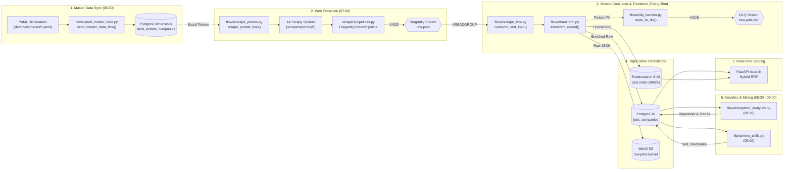
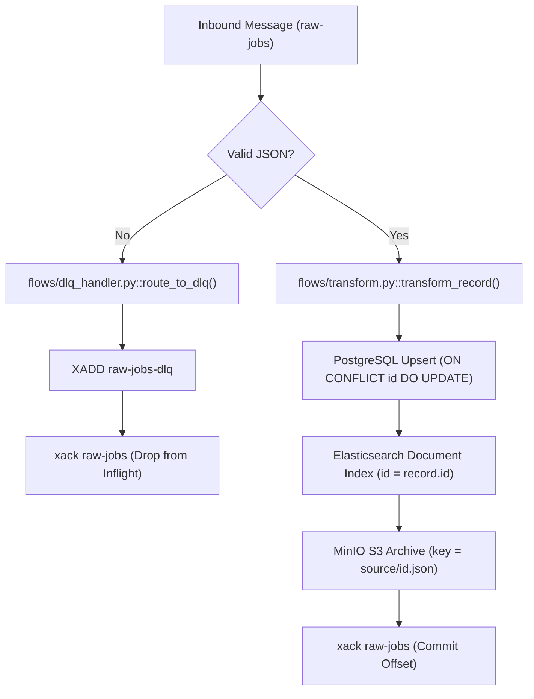
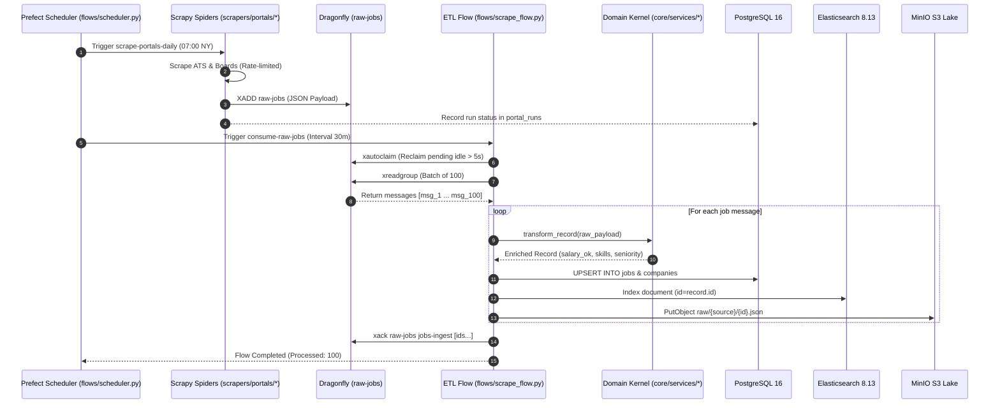
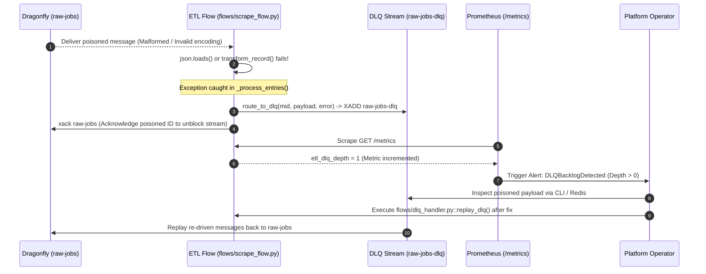

# 03 — Pipeline Execution & Orchestration Engine

- **Last-Analyzed Commit**: `8ff63675b59f0f5c1cd3d4bdcb3f8d74229ef6a5`
- **Audience**: Data Engineers, MLOps Engineers, Backend Developers, Platform Operators
- **Prerequisites**: Familiarity with Prefect 3, Redis Streams architecture, and asynchronous Python (`asyncio`, `asyncpg`)

> [!NOTE]
> **Assumptions & Open Questions**
> - **Assumption**: In-process `prefect.serve` deployment server ([flows/scheduler.py](file:///d:/job_se/flows/scheduler.py)) handles daily orchestration without requiring external Prefect Cloud connectivity.
> - **Open Question**: Will future crawler scale require transitioning from serial spider subprocesses to distributed Prefect task runners with worker pools?

---

## Table of Contents
1. [Sequential Pipeline Overview](#1-sequential-pipeline-overview)
2. [Sequential Pipeline Map (Mermaid Flowchart)](#2-sequential-pipeline-map-mermaid-flowchart)
3. [Per-Pipeline Specification Matrix](#3-per-pipeline-specification-matrix)
4. [Data Contracts Between Stages](#4-data-contracts-between-stages)
5. [State Management, Idempotency, and Checkpointing](#5-state-management-idempotency-and-checkpointing)
6. [Concurrency, Queueing & Locking Model](#6-concurrency-queueing--locking-model)
7. [Sequence Diagrams: Happy Path & Failure Path](#7-sequence-diagrams-happy-path--failure-path)
8. [Observability, Metrics & Telemetry](#8-observability-metrics--telemetry)
9. [Minute-Level Runtime Walkthrough](#9-minute-level-runtime-walkthrough)
10. [Change Log](#10-change-log)

---

## 1. Sequential Pipeline Overview

The platform executes as a **sequential, stage-gated data and GenAI engineering pipeline** where the output of each upstream stage establishes the dimensional foundation or streaming message queue for the next:

1. **Stage 1 (06:30 EST)**: Dimensional synchronization seeds reference tables.
2. **Stage 2 (07:00 EST)**: Web scrapers fan out and push raw records to Redis Streams.
3. **Stage 3 (Every 30m)**: Stream consumers batch-drain the queue, apply domain enrichment, and load to PostgreSQL, Elasticsearch, and MinIO.
4. **Stage 4 (08:30 EST)**: Analytics flows calculate daily trend snapshots.
5. **Stage 5 (09:00 EST)**: Unsupervised mining discovers novel technical skills.
6. **Real-Time**: Hybrid search serves candidates across pgvector and Elasticsearch via Reciprocal Rank Fusion ($k=60$).

---

## 2. Sequential Pipeline Map (Mermaid Flowchart)



---

## 3. Per-Pipeline Specification Matrix

| Pipeline Name | Trigger & Schedule | Input Data & Source | Processing Steps | Output Artifact & Destination | SLA | Retry Policy | Failure Mode & Recovery |
| :--- | :--- | :--- | :--- | :--- | :--- | :--- | :--- |
| **Master Data Seeding** | Cron: `30 6 * * *` (06:30 NY) via [flows/scheduler.py:L25](file:///d:/job_se/flows/scheduler.py#L25) | YAML files in `data/dictionaries/*.yaml` | 1. Parse YAML.<br/>2. Flatten hierarchies.<br/>3. Execute parameterized SQL upserts. | Dimension rows in `skills`, `portals`, `companies`, `job_titles`. | < 30 sec | 3 retries (Prefect default) | Aborts; logs error. Next run overwrites cleanly (idempotent upsert). |
| **Multi-Portal Extraction** | Cron: `0 7 * * *` (07:00 NY) via [flows/scheduler.py:L26](file:///d:/job_se/flows/scheduler.py#L26) | Remote job boards and ATS endpoints | 1. Fan out spiders over `companies.yaml`.<br/>2. Scrape with AutoThrottle.<br/>3. Normalize record.<br/>4. XADD to stream. | Messages in Dragonfly Stream `raw-jobs`; Run log in `portal_runs`. | < 45 min | 3 HTTP retries for 429/5xx codes ([scrapers/settings.py:L22](file:///d:/job_se/scrapers/settings.py#L22)) | Writes error string to `portal_runs.error` ([flows/scrape_portals.py:L100](file:///d:/job_se/flows/scrape_portals.py#L100)). Other spiders proceed. |
| **Stream Consumer ETL** | Interval: Every 1800s (30m) via [flows/scheduler.py:L27](file:///d:/job_se/flows/scheduler.py#L27) | Dragonfly Stream `raw-jobs` (group: `jobs-ingest`) | 1. `xautoclaim` pending messages.<br/>2. `xreadgroup` batch of 100.<br/>3. `transform_record()`.<br/>4. Multi-target load.<br/>5. `xack` IDs. | Relational rows in `jobs`, indexed docs in Elasticsearch, immutable JSON in MinIO. | < 5 min per batch | Auto-claim idle pending messages after 5000ms ([flows/scrape_flow.py:L274](file:///d:/job_se/flows/scrape_flow.py#L274)) | Poison pills routed to `raw-jobs-dlq` via `route_to_dlq()`. Poisoned message is ACKed to prevent blocking stream. |
| **Daily Analytics Snapshot** | Cron: `30 8 * * *` (08:30 NY) via [flows/scheduler.py:L29](file:///d:/job_se/flows/scheduler.py#L29) | PostgreSQL `jobs`, `companies` tables | 1. Query aggregate counts.<br/>2. Calculate skill and title distributions.<br/>3. Upsert daily snapshot records. | Rows in `analytics_snapshots`, `skill_trend`, `title_trend`, `company_hiring`. | < 60 sec | 2 retries, 30s delay | Aborts; logged to Prefect. Next run overwrites `snapshot_date`. |
| **Unsupervised Skill Mining** | Cron: `0 9 * * *` (09:00 NY) via [flows/scheduler.py:L30](file:///d:/job_se/flows/scheduler.py#L30) | PostgreSQL `jobs.description` text | 1. Regex scanning for technical phrases.<br/>2. Filter out known skills & stopwords.<br/>3. Upsert candidate frequencies. | Rows in `skill_candidates` table for human operator review/promotion. | < 5 min | 2 retries, 30s delay | Logs error to Prefect; no downstream pipeline breakage. |
| **Batch Semantic Embedding** | Ad-hoc / Event-driven via [flows/embed_jobs_flow.py](file:///d:/job_se/flows/embed_jobs_flow.py) | Unembedded rows (`jobs WHERE embedding IS NULL`) | 1. Fetch batch of 50-200 rows.<br/>2. Call OpenAI / Local embedding model.<br/>3. Update pgvector `embedding` column. | 1536-dim vectors indexed in pgvector HNSW index. | < 2 min per 100 rows | 3 retries with exponential backoff on HTTP 429/500 | Skips failed batch; resumes on next scheduled run. |
| **Hybrid Search & Serving** | On-demand via `GET /search` ([api/app/routers/search.py](file:///d:/job_se/api/app/routers/search.py)) | HTTP query string + query vector | 1. Embed user query.<br/>2. Concurrent pgvector and ES search.<br/>3. Reciprocal Rank Fusion ($k=60$). | JSON response containing ranked `SearchResultItem` list. | < 150 ms (P95) | In-process fallback | If hybrid retrieval fails, falls back automatically to lexical SQL ILIKE search ([search.py:L100](file:///d:/job_se/api/app/routers/search.py#L100)). |

---

## 4. Data Contracts Between Stages

### Contract A: Inbound Scraped Payload (Scraper $\rightarrow$ Stream)
Emitted by `scrapers/pipelines.py` ([scrapers/pipelines.py:L39](file:///d:/job_se/scrapers/pipelines.py#L39)) to Dragonfly Stream `raw-jobs`:

```json
{
  "id": "sha256(source:company:external_id)",
  "source": "string",
  "external_id": "string",
  "title": "string",
  "company": "string",
  "location": "string | null",
  "is_remote": true,
  "remote_type": "fully_remote | hybrid | on_site",
  "salary_min": 160000.0,
  "salary_max": 220000.0,
  "salary_currency": "USD",
  "salary_raw": "$160,000 - $220,000",
  "base_vs_tc": "base | total_comp | unknown",
  "posted_at": "ISO-8601 string | null",
  "description": "string",
  "url": "https://...",
  "raw": { "original": "..." }
}
```

### Contract B: Enriched Database Payload (Transform $\rightarrow$ Postgres/ES)
Produced by `flows/transform.py` ([flows/transform.py:L30](file:///d:/job_se/flows/transform.py#L30)):

```json
{
  "id": "64-char hex string",
  "salary_ok": true,
  "title_canonical": "Machine Learning Engineer",
  "seniority": "senior",
  "skills": [
    { "name": "PyTorch", "category": "ml_frameworks", "weight": 5 }
  ],
  "responsibilities": [
    { "area": "model_development", "phrase": "train and deploy deep learning models" }
  ]
}
```

---

## 5. State Management, Idempotency, and Checkpointing



- **Deterministic Primary Key**: `stable_id(source, external_id, company)` generates consistent SHA256 hashes ([scrapers/portals/common.py:L27](file:///d:/job_se/scrapers/portals/common.py#L27)). Re-crawling updates records in-place.
- **SQL Upserts**: `ON CONFLICT (id) DO UPDATE` refreshes timestamps and metadata without creating duplicates ([flows/scrape_flow.py:L62-84](file:///d:/job_se/flows/scrape_flow.py#L62-L84)).
- **Crash Recovery (`xautoclaim`)**: Consumer auto-claims unacknowledged messages idle for $> 5000\text{ms}$ upon startup ([flows/scrape_flow.py:L273](file:///d:/job_se/flows/scrape_flow.py#L273)), preventing in-flight message loss during pod restarts.

---

## 6. Concurrency, Queueing & Locking Model

| Component | Concurrency Model | Limits & Throttling | Resource Contention & Locking |
| :--- | :--- | :--- | :--- |
| **Prefect Scheduler** | In-process asyncio event loop | Single scheduler process ([flows/scheduler.py:L33](file:///d:/job_se/flows/scheduler.py#L33)) | Centralized scheduling; avoids duplicate flow runs. |
| **Scrapy Spiders** | Twisted Reactor (Event loop) | `CONCURRENT_REQUESTS_PER_DOMAIN = 2`<br/>`DOWNLOAD_DELAY = 1.0s` | Politeness throttled via AutoThrottle; avoids IP bans. |
| **Redis Stream Broker** | Dragonfly multi-threaded proactor | `--proactor_threads=2`<br/>`--maxmemory=512mb` | High-throughput non-blocking pipeline handling thousands of stream writes per second. |
| **ETL Consumer Worker** | Prefect async task runner | `BATCH_SIZE = 100`<br/>`block = 1000ms` | Batched consumption; claims exclusive ownership of message IDs within consumer group. |
| **PostgreSQL Connection Pool** | SQLAlchemy + `asyncpg` | `DB_POOL_SIZE = 10`<br/>`DB_MAX_OVERFLOW = 20`<br/>`pool_pre_ping = True` | Asynchronous non-blocking connection pool; uses row-level locking during `ON CONFLICT DO UPDATE`. |
| **Hybrid Search API** | `asyncio.gather(vector, bm25)` | Concurrent async tasks per HTTP request | Parallel fan-out to pgvector and Elasticsearch; bounds P95 latency to < 150ms. |

---

## 7. Sequence Diagrams: Happy Path & Failure Path

### Happy Path Execution



### Failure & DLQ Recovery Path



---

## 8. Observability, Metrics & Telemetry

Prometheus metrics exposed at `GET /metrics` ([api/app/main.py:L44](file:///d:/job_se/api/app/main.py#L44)):

```
# HELP etl_jobs_total Total canonical jobs by source
# TYPE etl_jobs_total gauge
etl_jobs_total{source="greenhouse"} 142
etl_jobs_total{source="remoteok"} 85

# HELP etl_stream_backlog Raw-jobs stream backlog (XLEN)
# TYPE etl_stream_backlog gauge
etl_stream_backlog 24

# HELP etl_dlq_depth Dead-letter queue backlog length
# TYPE etl_dlq_depth gauge
etl_dlq_depth 0
```

---

## 9. Minute-Level Runtime Walkthrough

| Timestamp (EST) | Stage | Component & File | Execution Event |
| :--- | :--- | :--- | :--- |
| **06:30:00** | Scheduler Trigger | [flows/scheduler.py:L35](file:///d:/job_se/flows/scheduler.py#L35) | Cron fires `seed-master-data` deployment. |
| **06:30:04** | Master Data Sync | [flows/seed_master_data.py:L57](file:///d:/job_se/flows/seed_master_data.py#L57) | Upserts 50+ skills, 10 portals, titles, and companies into PostgreSQL. Completes in ~3s. |
| **07:00:00** | Scraper Trigger | [flows/scheduler.py:L40](file:///d:/job_se/flows/scheduler.py#L40) | Cron fires `scrape-portals-daily` deployment. |
| **07:00:05 - 07:28:00** | Web Crawling | [scrapers/pipelines.py:L37](file:///d:/job_se/scrapers/pipelines.py#L37) | Spiders crawl remote boards; records emitted to Dragonfly stream `raw-jobs` via `XADD`. |
| **07:30:00** | Consumer Trigger | [flows/scheduler.py:L55](file:///d:/job_se/flows/scheduler.py#L55) | Interval timer fires `consume-raw-jobs`. |
| **07:30:02** | Recovery Check | [flows/scrape_flow.py:L273](file:///d:/job_se/flows/scrape_flow.py#L273) | Invokes `xautoclaim`, recovering unacknowledged messages from any previous crash. |
| **07:30:05 - 07:30:20** | Batch Transform | [flows/scrape_flow.py:L240](file:///d:/job_se/flows/scrape_flow.py#L240) | Drains 100 records; validates $150K threshold; upserts to Postgres, ES, and MinIO; issues `xack`. |
| **08:30:00** | Daily Snapshot | [flows/snapshot_analytics.py:L27](file:///d:/job_se/flows/snapshot_analytics.py#L27) | Computes trend snapshots and writes to `analytics_snapshots`, `skill_trend`, `title_trend`. |
| **09:00:00** | Skill Mining | [flows/mine_skills.py:L142](file:///d:/job_se/flows/mine_skills.py#L142) | Scans descriptions for novel terminology; populates `skill_candidates`. |
| **Real-Time** | Hybrid Serving | [api/app/routers/search.py:L24](file:///d:/job_se/api/app/routers/search.py#L24) | FastAPI executes concurrent vector + BM25 RRF queries for candidates in < 150ms. |

---

## 10. Change Log

| Version | Date | Author | Description of Changes |
| :--- | :--- | :--- | :--- |
| `1.0.0` | 2026-10-13 | Data Platform Team | Exhaustive pipeline execution document, sequence diagrams, and minute-level runtime walkthrough. |
