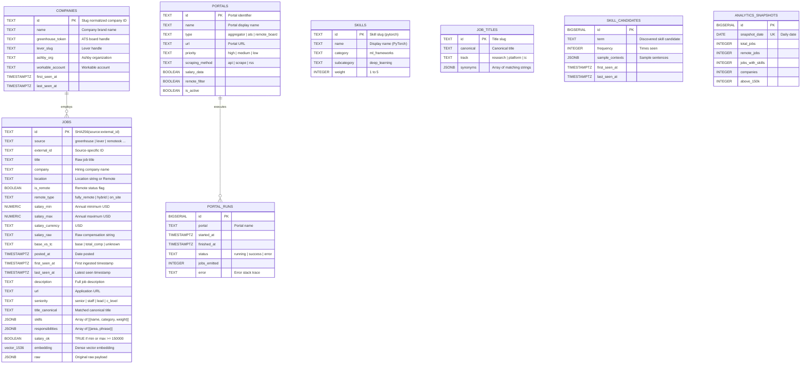

# 04 — Data Flow, Schemas & Storage Contracts

- **Last-Analyzed Commit**: `8ff63675b59f0f5c1cd3d4bdcb3f8d74229ef6a5`
- **Audience**: Database Administrators, Data Modelers, Backend Developers, Analytics Engineers
- **Prerequisites**: Proficiency in SQL DDL, PostgreSQL pgvector HNSW indexing, Elasticsearch index mappings, and JSON Schema

> [!NOTE]
> **Assumptions & Open Questions**
> - **Assumption**: 1536-dimensional vectors correspond to OpenAI `text-embedding-3-small`. If `sentence-transformers/all-MiniLM-L6-v2` is used, the vector column must be dimensioned to 384.
> - **Open Question**: Should partition pruning (PostgreSQL table partitioning by `posted_at::date`) be introduced once the `jobs` table exceeds 1,000,000 rows?

---

## Table of Contents
1. [End-to-End Data Flow Topology](#1-end-to-end-data-flow-topology)
2. [Entity-Relationship Diagram (Mermaid ERD)](#2-entity-relationship-diagram-mermaid-erd)
3. [Source Normalization & Ingestion Contracts](#3-source-normalization--ingestion-contracts)
4. [Relational Storage Schema (PostgreSQL 16)](#4-relational-storage-schema-postgresql-16)
5. [Vector Indexing & Semantic Search (pgvector)](#5-vector-indexing--semantic-search-pgvector)
6. [Lexical Search Schema (Elasticsearch 8.13)](#6-lexical-search-schema-elasticsearch-813)
7. [Object Storage Layout (MinIO S3 Data Lake)](#7-object-storage-layout-minio-s3-data-lake)
8. [Dead-Letter Queue (DLQ) Schema](#8-dead-letter-queue-dlq-schema)
9. [Change Log](#9-change-log)

---

## 1. End-to-End Data Flow Topology

Data transitions through four states: **Raw Web Extracted** $\rightarrow$ **Stream Buffered** $\rightarrow$ **Domain Enriched** $\rightarrow$ **Polyglot Persisted**:

```
[ Web Target ] 
      │ (HTML / REST)
      ▼
[ Scrapy Spider ] ──( Normalization )──> [ base_record() ]
                                                │
                                                ▼ (JSON)
                                   [ Dragonfly: 'raw-jobs' ]
                                                │
                                                ▼ (xreadgroup)
                                    [ transform_record() ]
                                     • compute_salary_ok()
                                     • canonicalize_title()
                                     • extract_skills()
                                                │
                       ┌────────────────────────┼────────────────────────┐
                       ▼                        ▼                        ▼
           [ PostgreSQL + pgvector ]   [ Elasticsearch 8.13 ]   [ MinIO S3 Lakehouse ]
           • Relational state          • Lexical BM25 index     • Immutable raw JSON
           • 1536-dim HNSW cosine      • Fast keyword search    • Date partitioned
```

---

## 2. Entity-Relationship Diagram (Mermaid ERD)



---

## 3. Source Normalization & Ingestion Contracts

### Normalization Primitives ([scrapers/portals/common.py](file:///d:/job_se/scrapers/portals/common.py))
- **Deterministic ID Generation**:
  ```python
  # scrapers/portals/common.py:L27
  def stable_id(source: str, external_id: str, company: str = "") -> str:
      slug = f"{source}:{company.strip().lower()}:{external_id}".encode("utf-8")
      return hashlib.sha256(slug).hexdigest()
  ```
- **Salary Range Extraction Regex**:
  Matches `$180k`, `$180,000 - $220,000`, `$180K-$220K`:
  ```python
  # scrapers/portals/common.py:L44
  SALARY_RANGE = re.compile(
      r"\$\s*(\d{2,3}(?:,\d{3})*|\d{2,3}\s*k)\s*(?:-|to)\s*\$?\s*(\d{2,3}(?:,\d{3})*|\d{2,3}\s*k)",
      re.IGNORECASE,
  )
  ```

---

## 4. Relational Storage Schema (PostgreSQL 16)

DDL extracted from [db/init/01_schema.sql](file:///d:/job_se/db/init/01_schema.sql) and [02_master_data.sql](file:///d:/job_se/db/init/02_master_data.sql):

```sql
-- db/init/01_schema.sql
CREATE EXTENSION IF NOT EXISTS vector;

CREATE TABLE IF NOT EXISTS jobs (
    id              TEXT PRIMARY KEY,
    source          TEXT NOT NULL,
    external_id     TEXT,
    title           TEXT NOT NULL,
    company         TEXT,
    location        TEXT,
    is_remote       BOOLEAN DEFAULT FALSE,
    remote_type     TEXT,
    salary_min      NUMERIC,
    salary_max      NUMERIC,
    salary_currency TEXT DEFAULT 'USD',
    salary_raw      TEXT,
    base_vs_tc      TEXT,
    posted_at       TIMESTAMPTZ,
    first_seen_at   TIMESTAMPTZ DEFAULT now(),
    last_seen_at    TIMESTAMPTZ DEFAULT now(),
    expires_at      TIMESTAMPTZ,
    description     TEXT,
    url             TEXT,
    seniority       TEXT,
    title_canonical TEXT,
    skills          JSONB DEFAULT '[]',
    responsibilities JSONB DEFAULT '[]',
    salary_ok       BOOLEAN DEFAULT FALSE,
    embedding       vector(1536),
    raw             JSONB
);

CREATE INDEX IF NOT EXISTS idx_jobs_salary ON jobs (salary_min) WHERE salary_min IS NOT NULL;
CREATE INDEX IF NOT EXISTS idx_jobs_remote ON jobs (is_remote);
CREATE INDEX IF NOT EXISTS idx_jobs_title ON jobs (title_canonical);
CREATE INDEX IF NOT EXISTS idx_jobs_posted ON jobs (posted_at DESC);
```

---

## 5. Vector Indexing & Semantic Search (pgvector)

DDL extracted from [db/init/05_embeddings.sql](file:///d:/job_se/db/init/05_embeddings.sql):

```sql
-- db/init/05_embeddings.sql
-- Tuned HNSW vector index for high-recall cosine similarity search
CREATE INDEX IF NOT EXISTS idx_jobs_embedding_hnsw 
ON jobs USING hnsw (embedding vector_cosine_ops)
WITH (m = 16, ef_construction = 64);

-- Helper procedure for cosine similarity matching
CREATE OR REPLACE FUNCTION match_jobs_by_vector(
    query_embedding vector(1536),
    match_threshold float DEFAULT 0.3,
    match_count int DEFAULT 50
)
RETURNS TABLE (
    id TEXT,
    title TEXT,
    company TEXT,
    location TEXT,
    is_remote BOOLEAN,
    salary_min NUMERIC,
    salary_max NUMERIC,
    posted_at TIMESTAMPTZ,
    url TEXT,
    seniority TEXT,
    similarity float
)
LANGUAGE sql STABLE
AS $$
    SELECT
        j.id, j.title, j.company, j.location, j.is_remote,
        j.salary_min, j.salary_max, j.posted_at, j.url, j.seniority,
        1 - (j.embedding <=> query_embedding) AS similarity
    FROM jobs j
    WHERE j.embedding IS NOT NULL
      AND (1 - (j.embedding <=> query_embedding)) >= match_threshold
    ORDER BY j.embedding <=> query_embedding ASC
    LIMIT match_count;
$$;
```

---

## 6. Lexical Search Schema (Elasticsearch 8.13)

Mappings provisioned by `flows/scrape_flow.py::ensure_es_index()` ([flows/scrape_flow.py:L198-226](file:///d:/job_se/flows/scrape_flow.py#L198-L226)):

```json
// flows/scrape_flow.py:L202
{
  "mappings": {
    "properties": {
      "id": { "type": "keyword" },
      "source": { "type": "keyword" },
      "title": { "type": "text" },
      "company": { "type": "keyword" },
      "location": { "type": "text" },
      "is_remote": { "type": "boolean" },
      "remote_type": { "type": "keyword" },
      "salary_min": { "type": "float" },
      "salary_max": { "type": "float" },
      "salary_currency": { "type": "keyword" },
      "posted_at": { "type": "date", "format": "date_optional_time||epoch_millis" },
      "description": { "type": "text" },
      "url": { "type": "keyword" },
      "seniority": { "type": "keyword" },
      "title_canonical": { "type": "keyword" },
      "skills": { "type": "keyword" },
      "responsibilities": { "type": "text" },
      "salary_ok": { "type": "boolean" }
    }
  }
}
```

---

## 7. Object Storage Layout (MinIO S3 Data Lake)

- **Bucket**: `raw-jobs` ([flows/scrape_flow.py:L47](file:///d:/job_se/flows/scrape_flow.py#L47)).
- **Partitioning Strategy**: `raw/{source}/{id}.json`.
- **Payload Spec**: Stores original un-mutated source payload exactly as scraped, ensuring reproducible re-parsing if domain extraction logic evolves.

```
raw-jobs/
├── greenhouse/
│   ├── a1b2c3d4e5f6...json
│   └── 9876543210ab...json
├── lever/
│   └── 4f5e6d7c8b9a...json
└── remoteok/
    └── e1f2a3b4c5d6...json
```

---

## 8. Dead-Letter Queue (DLQ) Schema

Stream: `raw-jobs-dlq` ([flows/dlq_handler.py:L14](file:///d:/job_se/flows/dlq_handler.py#L14)).

```json
// flows/dlq_handler.py:L30
{
  "original_id": "1728821000000-0",
  "failed_at": "1728821005.123",
  "error_type": "JSONDecodeError",
  "error_message": "Expecting value: line 1 column 1 (char 0)",
  "payload": "raw unparseable string content"
}
```

---

## 9. Change Log

| Version | Date | Author | Description of Changes |
| :--- | :--- | :--- | :--- |
| `1.0.0` | 2026-10-13 | Data Platform Team | Exhaustive schema contracts for PostgreSQL, pgvector HNSW, Elasticsearch BM25, and MinIO. |
