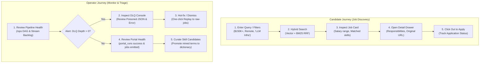
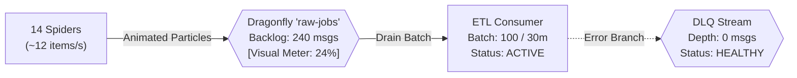

# 05 — UI/UX Expert Recommendation & Frontend Architecture

- **Last-Analyzed Commit**: `8ff63675b59f0f5c1cd3d4bdcb3f8d74229ef6a5`
- **Audience**: Product Designers, Frontend Engineers, Full-Stack Developers, Product Managers
- **Prerequisites**: Familiarity with modern SPA frameworks (React/Vite), Clean Architecture, and Design Systems (Tailwind / shadcn/ui)

> [!NOTE]
> **Assumptions & Open Questions**
> - **Assumption**: Single-Page Application (SPA) integrates directly with the existing FastAPI backend (`/jobs`, `/search`, `/stats`, `/metrics`).
> - **Open Question**: Should candidate bookmarks and saved search preferences be persisted in local browser storage (`localStorage`) or backed by user profiles in PostgreSQL?

---

## Table of Contents
1. [Executive Product Design Vision](#1-executive-product-design-vision)
2. [Persona $\rightarrow$ Job-to-be-Done (JTBD) Mapping](#2-persona--job-to-be-done-jtbd-mapping)
3. [Top User Journeys](#3-top-user-journeys)
4. [UI Paradigm Recommendation](#4-ui-paradigm-recommendation)
5. [Information Architecture (Sitemap)](#5-information-architecture-sitemap)
6. [Screen-by-Screen Specification](#6-screen-by-screen-specification)
7. [Frontend Stack & Component Library](#7-frontend-stack--component-library)
8. [Real-Time Pipeline Visualization](#8-real-time-pipeline-visualization)
9. [Accessibility, Theming & Responsiveness](#9-accessibility-theming--responsiveness)
10. [Low-Fidelity Wireframes for Top 5 Screens](#10-low-fidelity-wireframes-for-top-5-screens)
11. [UI Instrumentation & Success Metrics](#11-ui-instrumentation--success-metrics)
12. [Change Log](#12-change-log)

---

## 1. Executive Product Design Vision

The platform serves two complementary user archetypes:
1. **The Senior AI/ML Candidate**: Seeking verified \$150K+ USD remote roles, needing semantic search ("LLM inference kernels"), transparent compensation breakdowns, and skill match scoring.
2. **The Data / Platform Engineer**: Operating the 12-container backend, needing visibility into crawler runs (`portal_runs`), stream queue depth (`raw-jobs`), Dead-Letter Queue inspection, and one-click replay.

We recommend a **Unified Hybrid Web Application** built with **React + Vite + shadcn/ui**. It combines an exceptional, consumer-grade job discovery interface with an integrated engineering control plane accessible via a top navigation mode switch.

---

## 2. Persona $\rightarrow$ Job-to-be-Done (JTBD) Mapping

| Persona | Pain Points & Context | Job-to-be-Done (JTBD) Statement | Supporting Backend Feature |
| :--- | :--- | :--- | :--- |
| **Principal DS / AI Candidate** | • Bait-and-switch hybrid listings.<br/>• Ambiguous compensation.<br/>• Brittle keyword searches. | *"When I look for AI roles, I want to filter strictly for verified $150K+ USD fully-remote roles with semantic search, so that I don't waste time on irrelevant listings."* | • `GET /search?q=...&hybrid=true` ([api/app/routers/search.py:L24](file:///d:/job_se/api/app/routers/search.py#L24))<br/>• `GET /jobs?min_salary=150000` ([api/app/routers/jobs.py:L16](file:///d:/job_se/api/app/routers/jobs.py#L16))<br/>• `salary_ok` flag & `skills` weights |
| **Data / Platform Engineer** | • Silent spider failures.<br/>• Poisoned payloads blocking streams.<br/>• Invisible stream lag. | *"When a scraper breaks or a malformed payload is emitted, I want instant visual alerts and one-click DLQ replay, so that data ingestion remains continuous."* | • `GET /metrics` (`etl_dlq_depth`) ([api/app/main.py:L44](file:///d:/job_se/api/app/main.py#L44))<br/>• `portal_runs` table ([flows/scrape_portals.py:L55](file:///d:/job_se/flows/scrape_portals.py#L55))<br/>• `flows/dlq_handler.py::replay_dlq()` ([flows/dlq_handler.py:L57](file:///d:/job_se/flows/dlq_handler.py#L57)) |
| **Market / Talent Analyst** | • Lacks objective benchmark data on what stacks command $200K+. | *"When evaluating the market, I want automated salary benchmarks and skill momentum curves, so that I can identify compensation premiums."* | • `salary_benchmark` SQL view ([db/init/03_analytics.sql:L70](file:///d:/job_se/db/init/03_analytics.sql#L70))<br/>• `skill_momentum` view ([db/init/03_analytics.sql:L54](file:///d:/job_se/db/init/03_analytics.sql#L54)) |

---

## 3. Top User Journeys



---

## 4. UI Paradigm Recommendation

| Dimension | Streamlit | Multi-App (Next.js + Grafana) | Unified Hybrid SPA (Recommended) |
| :--- | :--- | :--- | :--- |
| **Candidate UX** | Poor (Clunky reloads) | High (Disjointed ops) | **Exceptional** (Bespoke design tokens, sub-second HMR) |
| **Ops Power** | Low (Basic tables) | Medium (Iframe charts) | **High** (Interactive DAG, inline JSON editor, replay) |
| **Effort** | Low (~2 days) | High (~4 weeks) | **Moderate (~1.5 weeks)** |
| **Verdict** | ❌ Rejected | ⚠️ Rejected | ✅ **RECOMMENDED** |

---

## 5. Information Architecture (Sitemap)

```
Platform Root (/)
├── [Candidate Discovery]
│   ├── /jobs                      ──> Primary Search Engine (Hybrid RRF, Filters, Cards)
│   │   └── /jobs/:id (Drawer)     ──> Detail Preview (Responsibilities, Skills, Apply Link)
│   ├── /market-insights           ──> Compensation Intelligence (Salary benchmarks, Momentum)
│   └── /saved                     ──> Bookmarked Jobs (LocalStorage persistence)
│
└── [Operations Control Plane] (/ops)
    ├── /ops/overview              ──> Ingestion Pipeline DAG, Stream Backpressure, Vitals
    ├── /ops/crawlers              ──> Spider Execution Telemetry (portal_runs, triggers)
    ├── /ops/dlq                   ──> Dead-Letter Queue Inspector & Replay Console
    ├── /ops/taxonomy              ──> Mined Skill Review (new_skill_candidates promotion)
    └── /ops/system                ──> Container Health & pgvector Embedding Coverage
```

---

## 6. Screen-by-Screen Specification

1. **Candidate Job Discovery (`/jobs`)**:
   - Hero search bar with Hybrid RRF toggle.
   - Faceted filters: Salary slider ($150K–$500K+), Remote pills, Seniority multiselect.
   - Job cards: Verified compensation badge, source tag, category-colored skill chips.
2. **Job Detail Preview Drawer (`/jobs/:id`)**:
   - Side drawer displaying title, company, salary bounds (Base vs Total Comp).
   - Radial skill match score (% matched based on user profile).
   - Extracted functional responsibilities and sanitized description.
3. **Market Intelligence & Benchmarks (`/market-insights`)**:
   - Box plots of salary distribution by canonical title (`salary_benchmark` view).
   - Month-over-month skill demand growth leaderboard (`skill_momentum` view).
4. **Data Ops Pipeline DAG (`/ops/overview`)**:
   - Live interactive DAG canvas showing spiders $\rightarrow$ Dragonfly stream $\rightarrow$ consumer $\rightarrow$ databases.
   - Stream backpressure meter (`raw-jobs` backlog) and pending message counter.
   - Scheduler countdown for next crawl.
5. **Dead-Letter Queue Console (`/ops/dlq`)**:
   - Banner alert displaying current DLQ depth (`etl_dlq_depth`).
   - Split-pane inspector: Left = stack trace; Right = editable raw JSON payload.
   - Action buttons: "Edit & Replay to raw-jobs", "Batch Replay 100", "Discard".

---

## 7. Frontend Stack & Component Library

- **Core**: React 18 + TypeScript + Vite.
- **Styling**: Tailwind CSS with custom zinc/slate design tokens.
- **Components**: shadcn/ui (Radix UI unstyled accessible primitives).
- **Icons**: Lucide React.
- **Data Fetching**: TanStack Query (React Query) with 10s telemetry polling.
- **Charts**: Recharts / Tremor for market salary distributions.

---

## 8. Real-Time Pipeline Visualization



- **Color Coding**:
  - Green: Backlog $< 1,000$ messages.
  - Amber: Backlog $1,000 - 5,000$ messages.
  - Red / Pulsing: Backlog $> 5,000$ messages.

---

## 9. Accessibility, Theming & Responsiveness

- **Accessibility**: Full WCAG 2.1 AA compliance, 4.5:1 text contrast ratio, keyboard navigation (`Tab`, `Esc` for drawers, `/` for search).
- **Theming**: Sleek Enterprise Dark Mode default (`#09090b` background) with glassmorphic cards; high-contrast Light Mode toggle.
- **Responsiveness**: 3-column desktop grid ($>1280\text{px}$), 2-column tablet layout ($768-1279\text{px}$), and single-column mobile view with bottom sheets.

---

## 10. Low-Fidelity Wireframes for Top 5 Screens

### Screen 1: Candidate Search (`/jobs`)
```
+----------------------------------------------------------------------------------------------------+
|  [LOGO] 150K+ REMOTE AI JOBS              [Mode: Candidate | ( Switch to Ops ) ]    [Theme: Dark]  |
+----------------------------------------------------------------------------------------------------+
|  [ Search: "Senior LLM / RAG Engineer"                                      ] [ Search ] [x] Hybrid|
+---------------------------------+------------------------------------------------------------------+
| FILTERS                         | RESULTS: 42 verified roles paying $150K+ USD       Sort: Newest v|
| --------------------------------+------------------------------------------------------------------+
| Minimum Salary                  | +--------------------------------------------------------------+ |
| [$150,000] =====o======== $500K | | Senior Machine Learning Engineer - LLM Systems               | |
|                                 | | Anthropic * Remote (US)                     $210K - $280K USD| |
| Remote Type                     | | [PyTorch] [vLLM] [Triton] [CUDA] [Kubernetes]       2h ago   | |
| [x] Fully Remote  [ ] Hybrid    | +--------------------------------------------------------------+ |
|                                 | +--------------------------------------------------------------+ |
| Seniority Level                 | | Staff AI Infrastructure Engineer                             | |
| [x] Senior  [x] Staff  [ ] Lead | | Character.ai * Remote (US)                  $240K - $320K USD| |
|                                 | | [Ray] [DeepSpeed] [Distributed Training]             4h ago   | |
| [ Clear All Filters ]           | +--------------------------------------------------------------+ |
+---------------------------------+------------------------------------------------------------------+
```

### Screen 2: Job Detail Drawer (`/jobs/:id`)
```
+----------------------------------------------------------------------------------------------------+
|                                                  | JOB DETAIL PREVIEW                         [X]  |
|                                                  | ----------------------------------------------- |
|                                                  | Senior Machine Learning Engineer - LLM Systems  |
|                                                  | Anthropic | Remote (US)                         |
|                                                  | Verified Compensation: $210,000 - $280,000 USD  |
|                                                  | ----------------------------------------------- |
|                                                  | YOUR SKILL MATCH SCORE: [ 85% Match ]           |
|                                                  | Matched: [PyTorch] [vLLM] [Triton] [CUDA]       |
|                                                  | Missing: [Distributed Systems]                  |
|                                                  | ----------------------------------------------- |
|                                                  | [ APPLY ON ANTHROPIC CAREERS -> ]  [ Bookmark ] |
+--------------------------------------------------+-------------------------------------------------+
```

### Screen 3: Market Compensation & Trends (`/market-insights`)
```
+----------------------------------------------------------------------------------------------------+
|  [MARKET INSIGHTS] Compensation Benchmarks & AI Skill Trends                         Last 30 Days v|
+----------------------------------------------------------------------------------------------------+
|  [ Avg Base: $184,500 ]    [ Median Max: $240,000 ]    [ Fully Remote: 94.2% ]   [ Jobs: 1,482 ]   |
+----------------------------------------------------------------------------------------------------+
| SALARY BY CANONICAL ROLE ($USD)                  | TOP EMERGING AI SKILLS (Month-over-Month Growth) |
| ------------------------------------------------+--------------------------------------------------|
| AI Research Scientist:   ======o======== $265K  | 1. vLLM                    +84% demand           |
| MLOps Platform Engineer: ====o========== $210K  | 2. Agentic AI / LangGraph  +62% demand           |
| Machine Learning Eng:    ===o=========== $195K  | 3. Triton Kernels          +45% demand           |
+-------------------------------------------------+--------------------------------------------------+
```

### Screen 4: Data Operations DAG & Stream Monitor (`/ops/overview`)
```
+----------------------------------------------------------------------------------------------------+
|  [DATA OPS CONTROL PLANE] Pipeline Health & Real-Time Telemetry                Status: ALL HEALTHY |
+----------------------------------------------------------------------------------------------------+
|  INGESTION PIPELINE TOPOLOGY                                                                       |
|                                                                                                    |
|  [ 14 Spiders ] ===( 18 items/s )===> [ Dragonfly Stream ] ===( 100/batch )===> [ Postgres 16 ]    |
|  (Greenhouse, RemoteOK, Remotive)      Backlog: 120 msgs                        (jobs / companies) |
|                                        Pending: 0 msgs                                 |           |
|                                                |                                       v           |
|                                                v                                [ Elastic 8.13 ]   |
|                                       [ DLQ: 0 msgs (OK) ]                      [ MinIO S3 Lake ]  |
+----------------------------------------------------------------------------------------------------+
```

### Screen 5: Dead-Letter Queue Inspector & Replay Console (`/ops/dlq`)
```
+----------------------------------------------------------------------------------------------------+
|  [DEAD-LETTER QUEUE CONSOLE] Triage & Poison-Pill Replay                      Current Backlog: 2   |
+----------------------------------------------------------------------------------------------------+
|  [ Replay All Messages (2) ]   [ Purge / Clear DLQ ]                                               |
| -------------------------------------------------------------------------------------------------- |
| ID           | Failed At         | Error Type           | Source       | Action                    |
| 17288210-0   | 07:30:12 EST      | JSONDecodeError      | remotive     | [ Inspect ] [ Replay ]    |
| 17288214-0   | 07:30:15 EST      | InvalidSalaryRange   | arbeitnow    | [ Inspect ] [ Replay ]    |
+----------------------------------------------------------------------------------------------------+
| PAYLOAD INSPECTION PANE: Message #17288210-0                                                       |
| -------------------------------------------------------------------------------------------------- |
| ERROR STACK TRACE:                                                                                 |
| json.decoder.JSONDecodeError: Unterminated string starting at line 1 column 124                    |
|                                                                                                    |
| [ Edit & Replay to raw-jobs ]                 [ Discard / Drop Message ]                           |
+----------------------------------------------------------------------------------------------------+
```

---

## 11. UI Instrumentation & Success Metrics

- **Time-to-First-Apply (TTFA)**: Target $< 90\text{ seconds}$.
- **Search Click-Through Rate (CTR)**: Target $> 35\%$.
- **Hybrid Search Preference Ratio**: Target $> 70\%$ retention of `hybrid=true`.
- **Mean-Time-to-Resolve (MTTR) via UI**: Target $< 10\text{ minutes}$ for DLQ poison pills.

---

## 12. Change Log

| Version | Date | Author | Description of Changes |
| :--- | :--- | :--- | :--- |
| `1.0.0` | 2026-10-13 | Senior UX/UI Architect | Complete Unified Hybrid SPA specification, wireframes, IA sitemap, and telemetry metrics. |
