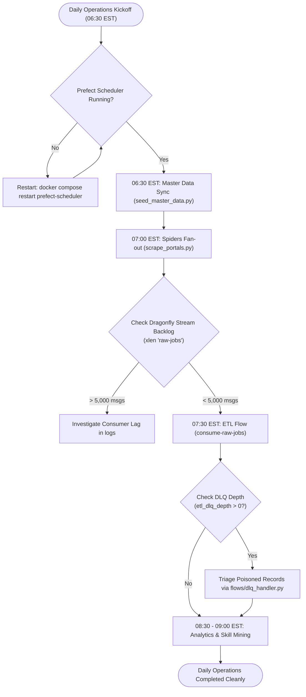

# 06 — End-User Guide, Operations & Tasks Cookbook

- **Last-Analyzed Commit**: `8ff63675b59f0f5c1cd3d4bdcb3f8d74229ef6a5`
- **Audience**: All Users (Developers, DevOps, Analysts, Job Seekers)
- **Prerequisites**: Terminal access, Docker Compose installed, Git

> [!NOTE]
> **Assumptions & Open Questions**
> - **Assumption**: Local developer workstations execute `docker-compose.yml` or fallback to `run_all.bat`.
> - **Open Question**: Will future deployments require a unified CLI tool (e.g. `job-ctl`) for operations?

---

## Table of Contents
1. [Persona-Specific Quickstarts](#1-persona-specific-quickstarts)
2. [Prerequisites & Step-by-Step Setup](#2-prerequisites--step-by-step-setup)
3. [Standard Operating Workflow](#3-standard-operating-workflow)
4. [Common Tasks Cookbook](#4-common-tasks-cookbook)
5. [Troubleshooting Matrix](#5-troubleshooting-matrix)
6. [Frequently Asked Questions (FAQ)](#6-frequently-asked-questions-faq)
7. [Change Log](#7-change-log)

---

## 1. Persona-Specific Quickstarts

### Developer Quickstart
```bash
# 1. Setup local environment
python -m venv .venv && source .venv/bin/activate  # On Windows: .venv\Scripts\activate
pip install -r requirements-dev.txt -r api/requirements.txt

# 2. Run unit and integration tests
pytest tests/ -v

# 3. Execute local end-to-end verification harness
python scripts/verify_all_pipelines.py
```

### DevOps / Operator Quickstart
```bash
# 1. Boot 12-service infrastructure
cp .env.example .env && make up

# 2. Migrate database schemas & seed master data
make migrate && make seed-master

# 3. Trigger all web crawlers
make scrape-all

# 4. Access Grafana monitoring
# Open: http://localhost:3100 (admin / admin)
```

### Analyst Quickstart
```bash
# 1. Setup Metabase dashboard cards
docker compose exec -T prefect-scheduler python - < scripts/setup_metabase.py

# 2. Access Metabase BI portal
# Open: http://localhost:3101
```

### Job Seeker Quickstart
```bash
# 1. Query $150K+ remote AI roles via FastAPI
curl -s "http://localhost:8000/jobs?min_salary=150000&remote=true" | jq .

# 2. Or explore interactive Swagger UI
# Open: http://localhost:8000/docs
```

---

## 2. Prerequisites & Step-by-Step Setup

```bash
# Step 1: Copy environment configuration
cp .env.example .env

# Step 2: Start datastores & message broker
docker compose up -d postgres dragonfly elasticsearch minio

# Step 3: Run database migrations
docker compose run --rm prefect-init
docker compose exec -T postgres psql -U postgres -d jobs < db/init/02_master_data.sql
docker compose exec -T postgres psql -U postgres -d jobs < db/init/03_analytics.sql
docker compose exec -T postgres psql -U postgres -d jobs < db/init/04_skill_mining.sql
docker compose exec -T postgres psql -U postgres -d jobs < db/init/05_embeddings.sql

# Step 4: Start orchestrator, API, and scrapers
docker compose up -d prefect-server prefect-scheduler api scraper

# Step 5: Seed master data dimensions
docker compose exec -T prefect-scheduler python /opt/prefect/flows/seed_master_data.py
```

---

## 3. Standard Operating Workflow



---

## 4. Common Tasks Cookbook

### Task 1: How to Add a New Portal Spider
1. Create `scrapers/portals/<name>_spider.py` using `scrapers/portals/common.py::base_record()` ([common.py:L90](file:///d:/job_se/scrapers/portals/common.py#L90)).
2. Add spider to `STANDALONE_SPIDERS` in [flows/scrape_portals.py:L35](file:///d:/job_se/flows/scrape_portals.py#L35).
3. Test crawling:
   ```bash
   docker compose run --rm scraper scrapy crawl <name>
   ```

### Task 2: How to Re-run a Single Spider
```bash
make scrape SPIDER=remoteok
```

### Task 3: How to Backfill Vector Embeddings
```bash
docker compose exec -T prefect-scheduler python /opt/prefect/flows/embed_jobs_flow.py
```

### Task 4: How to Replay Dead-Letter Queue (DLQ) Messages
```bash
docker compose exec -T prefect-scheduler python -c "
import redis, os
from flows.dlq_handler import replay_dlq
client = redis.Redis.from_url(os.getenv('DRAGONFLY_URL', 'redis://dragonfly:6379/0'))
replay_dlq(client, target_stream='raw-jobs', count=100)
"
```

### Task 5: How to Scale Spark Workers
```bash
docker compose up -d --scale spark-worker=3
```

---

## 5. Troubleshooting Matrix

| Symptom | Likely Cause | Diagnosis Command | Remediation Fix |
| :--- | :--- | :--- | :--- |
| **Spiders failing with HTTP 429** | Target rate limit triggered. | `docker compose logs scraper \| grep "429"` | Increase `DOWNLOAD_DELAY=3.0` in [scrapers/settings.py:L16](file:///d:/job_se/scrapers/settings.py#L16). |
| **`etl_dlq_depth > 0`** | Poison pill in stream. | `docker compose exec dragonfly redis-cli XLEN raw-jobs-dlq` | Inspect via `XRANGE raw-jobs-dlq - + COUNT 1`, patch parser, and call `replay_dlq()`. |
| **Stream Backlog > 5,000** | Consumer flow stalled. | `docker compose logs prefect-scheduler` | Run ad-hoc consumer: `make prefect-flows`. |
| **Elasticsearch Status RED** | ES memory OOM crash. | `curl -s http://localhost:9200/_cluster/health` | Restart ES: `docker compose restart elasticsearch`. Allocate $\ge 4\text{GB}$ Docker RAM. |
| **Search API returns SQL fallback** | Hybrid search error. | `docker compose logs api \| grep "Fallback to lexical SQL"` | Check `OPENAI_API_KEY` in `.env` and verify vector coverage in PostgreSQL. |

---

## 6. Frequently Asked Questions (FAQ)

- **Q: Why Dragonfly instead of Kafka?** Dragonfly provides full Redis Streams API compatibility with sub-millisecond latency and $<100\text{MB}$ idle memory, avoiding heavy JVM overhead.
- **Q: What happens if a job lists no salary?** `salary_ok` is strictly flagged as `False`, excluding it from the $150K+ filtered query view while retaining searchability.
- **Q: Can I run without Docker?** Yes. Execute `run_all.bat` on Windows; it auto-detects Docker absence and runs direct local ETL outputting to `data/real_jobs_enriched.json`.

---

## 7. Change Log

| Version | Date | Author | Description of Changes |
| :--- | :--- | :--- | :--- |
| `1.0.0` | 2026-10-13 | Operations Team | Initial comprehensive user guide, cookbook recipes, and troubleshooting matrix. |
