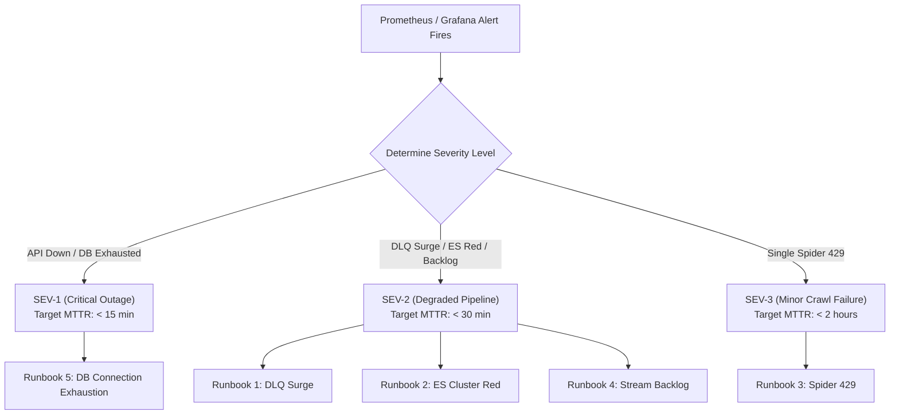

# 07 — Incident Response Runbooks & Disaster Recovery

- **Last-Analyzed Commit**: `8ff63675b59f0f5c1cd3d4bdcb3f8d74229ef6a5`
- **Audience**: SRE, DevOps Engineers, On-Call Backend Developers
- **Prerequisites**: Terminal access to Docker host, `docker compose`, `psql`, `redis-cli`, `curl`

> [!NOTE]
> **Assumptions & Open Questions**
> - **Assumption**: Single-node Docker deployment allows direct execution of `docker compose exec` commands for recovery.
> - **Open Question**: When migrating to Kubernetes, what automated alert webhook (PagerDuty, Slack) will trigger on `etl_dlq_depth > 0`?

---

## Table of Contents
1. [Incident Triage Protocol](#1-incident-triage-protocol)
2. [Runbook 1: Dead-Letter Queue Surge (`etl_dlq_depth > 10`)](#2-runbook-1-dead-letter-queue-surge-etl_dlq_depth--10)
3. [Runbook 2: Elasticsearch Memory Crash / Cluster Status RED](#3-runbook-2-elasticsearch-memory-crash--cluster-status-red)
4. [Runbook 3: Scraper IP Ban & Rampant HTTP 429 Errors](#4-runbook-3-scraper-ip-ban--rampant-http-429-errors)
5. [Runbook 4: Dragonfly Stream Backpressure & Consumer Stall](#5-runbook-4-dragonfly-stream-backpressure--consumer-stall)
6. [Runbook 5: PostgreSQL Database Connection Exhaustion](#6-runbook-5-postgresql-database-connection-exhaustion)
7. [Change Log](#7-change-log)

---

## 1. Incident Triage Protocol



---

## 2. Runbook 1: Dead-Letter Queue Surge (`etl_dlq_depth > 10`)

- **Severity**: **SEV-2 (High)**
- **Trigger**: Prometheus metric `etl_dlq_depth > 0` ([api/app/main.py:L141](file:///d:/job_se/api/app/main.py#L141)).
- **Symptoms**: Messages are diverted to `raw-jobs-dlq`; jobs count stalls.

### Diagnostic Steps:
```bash
# 1. Check current DLQ length
docker compose exec -T dragonfly redis-cli XLEN raw-jobs-dlq

# 2. Inspect the most recent failed message and stack trace
docker compose exec -T dragonfly redis-cli XRANGE raw-jobs-dlq - + COUNT 1
```

### Remediation Steps:
1. Identify the failing error type from the payload (e.g. `JSONDecodeError`, unhandled date string).
2. If due to a novel date format, patch `flows/scrape_flow.py::_parse_dt()` ([flows/scrape_flow.py:L135](file:///d:/job_se/flows/scrape_flow.py#L135)).
3. Re-drive all backlogged DLQ messages into the primary ingestion stream:
   ```bash
   docker compose exec -T prefect-scheduler python -c "
   import redis, os
   from flows.dlq_handler import replay_dlq
   client = redis.Redis.from_url(os.getenv('DRAGONFLY_URL', 'redis://dragonfly:6379/0'))
   replayed = replay_dlq(client, target_stream='raw-jobs', count=500)
   print(f'Replayed {replayed} messages to raw-jobs.')
   "
   ```
4. Verify `XLEN raw-jobs-dlq` returns `0`.

---

## 3. Runbook 2: Elasticsearch Memory Crash / Cluster Status RED

- **Severity**: **SEV-2 (High)**
- **Trigger**: Elasticsearch health probe fails; `/search` falls back to SQL.
- **Symptoms**: Container `job-search-elasticsearch` exited (OOM) or returns HTTP 503.

### Diagnostic Steps:
```bash
# 1. Check container process status
docker compose ps elasticsearch

# 2. Inspect exit logs for Out Of Memory (OOM) Killer
docker compose logs --tail=50 elasticsearch | grep -E "OutOfMemory|killed|fatal"

# 3. Query cluster health API
curl -sf http://localhost:9200/_cluster/health | jq .
```

### Remediation Steps:
1. If exited due to host memory pressure, restart Elasticsearch:
   ```bash
   docker compose restart elasticsearch
   ```
2. Wait 20 seconds and verify health:
   ```bash
   curl -sf http://localhost:9200/_cluster/health | grep -vq '"status":"red"' && echo "ES is Healthy"
   ```
3. If memory is permanently constrained, adjust `ES_JAVA_OPTS` in `docker-compose.yml`:
   ```yaml
   ES_JAVA_OPTS: "-Xms1g -Xmx1g"
   ```
4. Re-index any missing records from PostgreSQL:
   ```bash
   make prefect-flows
   ```

---

## 4. Runbook 3: Scraper IP Ban & Rampant HTTP 429 Errors

- **Severity**: **SEV-3 (Medium)**
- **Trigger**: Multiple rows in `portal_runs` record `status='error'` with HTTP 429.
- **Symptoms**: Crawlers fail to harvest jobs from specific job boards.

### Diagnostic Steps:
```bash
# Query recent crawler failures in PostgreSQL
docker compose exec -it postgres psql -U postgres -d jobs -c "
SELECT portal, error, started_at, finished_at 
FROM portal_runs 
WHERE status = 'error' 
ORDER BY finished_at DESC LIMIT 5;
"
```

### Remediation Steps:
1. Temporarily deactivate the affected spider in [flows/scrape_portals.py:L35](file:///d:/job_se/flows/scrape_portals.py#L35).
2. Increase download delay in [scrapers/settings.py:L16-21](file:///d:/job_se/scrapers/settings.py#L16-L21):
   ```python
   DOWNLOAD_DELAY = 5.0
   AUTOTHROTTLE_START_DELAY = 5.0
   AUTOTHROTTLE_MAX_DELAY = 30.0
   ```
3. Re-deploy the scraper service:
   ```bash
   docker compose up -d --build scraper
   ```

---

## 5. Runbook 4: Dragonfly Stream Backpressure & Consumer Stall

- **Severity**: **SEV-2 (High)**
- **Trigger**: Prometheus metric `etl_stream_backlog > 5000` ([api/app/main.py:L137](file:///d:/job_se/api/app/main.py#L137)).
- **Symptoms**: Newly scraped jobs do not appear in PostgreSQL or Elasticsearch.

### Diagnostic Steps:
```bash
# 1. Check current backlog length (XLEN)
docker compose exec -T dragonfly redis-cli XLEN raw-jobs

# 2. Check pending unacknowledged messages (XPENDING)
docker compose exec -T dragonfly redis-cli XPENDING raw-jobs jobs-ingest

# 3. Inspect scheduler logs for hung consumer loops
docker compose logs --tail=100 prefect-scheduler | grep "consume-raw-jobs"
```

### Remediation Steps:
1. If consumer process crashed, restart the scheduler:
   ```bash
   docker compose restart prefect-scheduler
   ```
2. Manually trigger an immediate bulk drain of the stream:
   ```bash
   docker compose exec -T prefect-scheduler python /opt/prefect/flows/scrape_flow.py
   ```
3. Monitor `XLEN raw-jobs` until queue depth returns to `< 100`.

---

## 6. Runbook 5: PostgreSQL Database Connection Exhaustion

- **Severity**: **SEV-1 (Critical)**
- **Trigger**: FastAPI logs `503 Database error: too many clients already`.
- **Symptoms**: All API queries, crawlers, and orchestrator runs fail with connection errors.

### Diagnostic Steps:
```bash
# 1. Query connection counts by state
docker compose exec -it postgres psql -U postgres -d jobs -c "
SELECT count(*), state FROM pg_stat_activity GROUP BY state;
"

# 2. Identify clients holding open connections
docker compose exec -it postgres psql -U postgres -d jobs -c "
SELECT pid, usename, client_addr, state, query_start, query 
FROM pg_stat_activity 
WHERE state = 'idle in transaction' OR state = 'idle';
"
```

### Remediation Steps:
1. Terminate all idle connections immediately:
   ```bash
   docker compose exec -it postgres psql -U postgres -d jobs -c "
   SELECT pg_terminate_backend(pid) 
   FROM pg_stat_activity 
   WHERE state = 'idle' AND pid <> pg_backend_pid();
   "
   ```
2. Restart the FastAPI service to reset leaky async connection pools:
   ```bash
   docker compose restart api
   ```
3. Verify connection pool limits in `config/settings.py` ([config/settings.py:L41-42](file:///d:/job_se/config/settings.py#L41-L42)):
   ```python
   db_pool_size: int = 10
   db_max_overflow: int = 20
   ```

---

## 7. Change Log

| Version | Date | Author | Description of Changes |
| :--- | :--- | :--- | :--- |
| `1.0.0` | 2026-10-13 | SRE Operations Team | Complete incident response runbooks for top 5 production outage scenarios. |
