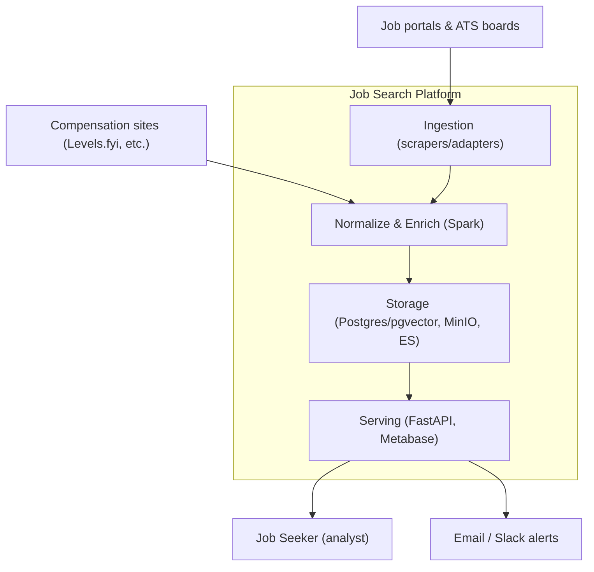
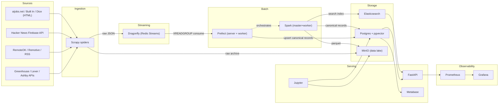

# Architecture

## Context (C4 Level 1)

## Container / Data Flow (C4 Level 2)

## Component Rationale

| Component | Why |
|-----------|-----|
| **Postgres + pgvector** | Single source of truth for canonical records; pgvector adds semantic search without a separate vector DB |
| **Elasticsearch** | Fast full-text search over descriptions; faceted filters (title, seniority, salary) |
| **MinIO** | S3-compatible lake for raw JSON + parquet; cheap, local, Spark-native |
| **Dragonfly (Redis Streams)** | Decouples ingest from processing; replayable stream (XADD/XREADGROUP); also serves as cache/rate-limit store |
| **Spark** | Batch normalization/dedup at scale; reads MinIO, writes Postgres/ES |
| **Prefect** | Python-native orchestration; schedules scraper + normalize flows; retries |
| **FastAPI** | Query API for `/jobs`, `/stats`, semantic search |
| **Metabase** | Self-serve dashboards (no-code BI) |
| **Jupyter** | Ad-hoc analysis over Postgres/MinIO |
| **Prometheus + Grafana** | Scraper health, pipeline latency, API metrics |

## Scaling Notes

- **Ingest**: Start with ATS JSON APIs (no HTML parsing, low ToS risk). Add
  HTML scrapers behind polite throttling; scale via a Dragonfly (Redis-compatible)
  distributed crawl frontier if volume grows.
- **Dragonfly (Redis Streams)**: XADD/XREADGROUP consumer groups decouple ingest
  from processing; the `raw-jobs` stream is replayable and survives consumer
  restarts. Use XAUTOCLAIM to redeliver messages that were not XACKed. A single
  multi-threaded node is fine to ~100k msgs/day; shard for higher volume.
- **Spark**: Dev runs on 2 cores/2G. Scale worker memory/cores via
  `SPARK_WORKER_MEMORY`/`SPARK_WORKER_CORES`; for real scale use EMR/Glue or
  a K8s Spark operator.
- **MinIO → Spark**: Requires `hadoop-aws` + `aws-java-sdk-bundle` jars on the
  Spark classpath (see comment in `docker-compose.yml`); enable `s3a://` for
  lake reads/writes.
- **Postgres**: Add read replicas or PgBouncer when API + Metabase + Spark
  contend for connections. `hnsw` index scales to ~1M embeddings.
- **Elasticsearch**: single-node dev config (security disabled). For prod,
  re-enable security + TLS and use 3 nodes.

## Port Map

| Service | Port |
|---------|------|
| Postgres | 5432 |
| Elasticsearch | 9200 |
| Dragonfly (Redis-compatible) | 6379 |
| MinIO (S3 / console) | 9000 / 9001 |
| Spark master / worker UI | 8080 / 8081 |
| Prefect server | 4200 |
| Jupyter | 8888 |
| Metabase | 3001 |
| FastAPI | 8000 |
| Prometheus | 9090 |
| Grafana | 3000 |
