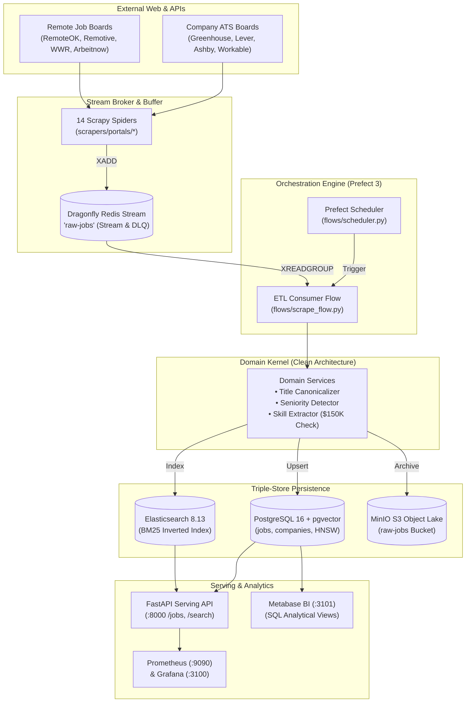

# Enterprise Remote $150K+ DS/AI/ML Job Search Platform — Architecture & Documentation Bundle

- **Last-Analyzed Commit**: `8ff63675b59f0f5c1cd3d4bdcb3f8d74229ef6a5`
- **Audience**: Platform Architects, Data Engineers, Full-Stack Developers, DevOps/SRE, Product Designers
- **Prerequisites**: Working knowledge of Docker Compose, Python 3.11+, Stream Processing (Redis Streams), and Clean Architecture

> [!NOTE]
> **Assumptions & Open Questions**
> - **Assumption**: Single-node Docker Compose workstation deployment is the primary current runtime target; future cloud evolution targets Kubernetes/EKS.
> - **Assumption**: Ethical scraping compliance is strictly enforced per [docs/COMPLIANCE.md](file:///d:/job_se/docs/COMPLIANCE.md) (no LinkedIn scraping, respecting `robots.txt`, Polite AutoThrottle).
> - **Open Question**: Will production authentication use corporate OAuth2/OIDC (e.g. Okta, Auth0) or standard asymmetric JWT (RS256) key rotation?

---

## Table of Contents
1. [Executive Summary](#1-executive-summary)
2. [Documentation Bundle Navigation](#2-documentation-bundle-navigation)
3. [System Architecture at a Glance](#3-system-architecture-at-a-glance)
4. [High-Level Data & Control Flow](#4-high-level-data--control-flow)
5. [Key Platform Capabilities](#5-key-platform-capabilities)
6. [Change Log](#6-change-log)

---

## 1. Executive Summary

The **Remote 150K+ DS/AI/ML Job Search Platform** is an enterprise data and GenAI engineering system designed to collect, normalize, enrich, and serve remote Data Science, Machine Learning, and Artificial Intelligence job postings paying **$150,000+ USD** in the US market.

The system replaces traditional batch scraping architectures with an event-driven, modular-monolith pipeline:
- **Crawling & Extraction**: 14 Scrapy spiders fan out over company Applicant Tracking Systems (ATS: Greenhouse, Lever, Ashby, Workable) and specialized tech job boards (RemoteOK, Remotive, WWR, Arbeitnow), emitting raw items to a high-throughput **Dragonfly Redis Stream** (`raw-jobs`).
- **Transform & Ingestion**: Prefect 3 schedules asynchronous consumer flows draining batches of 100 messages, validating compensation thresholds, canonicalizing noisy job titles, detecting seniority levels, and extracting technical skills against taxonomy dictionaries.
- **Triple-Store Persistence**: Enriched jobs are atomically upserted into **PostgreSQL 16 + pgvector** (relational + HNSW vector index), indexed into **Elasticsearch 8.13** (lexical BM25 search), and archived in immutable format to **MinIO S3** cold storage.
- **Serving & Hybrid Search**: An asynchronous **FastAPI** application serves candidate queries via Reciprocal Rank Fusion (RRF) combining dense OpenAI vectors (`text-embedding-3-small`) and lexical BM25 matching, with sub-150ms P95 latency.

---

## 2. Documentation Bundle Navigation

This documentation bundle provides an exhaustive, minute-level technical breakdown of the entire platform:

| Document | Primary Audience | Core Contents & Focus Areas |
| :--- | :--- | :--- |
| [01-architecture.md](./01-architecture.md) | Architects & Leads | System topology, tech stack inventory, C4 diagrams, container specifications, entry points, and configuration surface. |
| [02-modules.md](./02-modules.md) | Software Engineers | Exhaustive layer-by-layer decomposition (Ingestion, Transform, AI/RAG, Orchestration, Storage, Serving, Observability, Auth). |
| [03-pipelines.md](./03-pipelines.md) | Data Engineers | Sequential execution DAG, 7-pipeline specification matrix, concurrency models, and minute-level timeline. |
| [04-data-flow.md](./04-data-flow.md) | Engineers & DBAs | Data contracts, JSON schemas, SQL DDL, HNSW indexing, stream buffering, and DLQ poison-pill isolation. |
| [05-ui-recommendation.md](./05-ui-recommendation.md) | UX Designers & Devs | Dual-persona JTBD mapping, Unified Hybrid SPA spec (React + Vite + shadcn/ui), wireframes, and telemetry metrics. |
| [06-user-guide.md](./06-user-guide.md) | All Users | Step-by-step installation, persona quickstarts, standard operating workflows, and common task cookbook recipes. |
| [07-runbooks.md](./07-runbooks.md) | SRE & Operations | Incident response runbooks for top 5 failure scenarios (DLQ surges, ES crashes, rate limits, connection exhaustion). |
| [08-risks-and-roadmap.md](./08-risks-and-roadmap.md) | Tech Leads & Ops | Architectural SPOFs, critical security vulnerability audit, performance bottlenecks, tech debt register, and roadmap. |
| [09-glossary.md](./09-glossary.md) | All Users | Comprehensive domain definitions, acronyms, and codebase-specific terms. |
| [appendix/file-inventory.md](./appendix/file-inventory.md) | Developers | Exhaustive file-by-file directory map citing every file, line count, status, and responsibility. |

---

## 3. System Architecture at a Glance

---

## 4. High-Level Data & Control Flow

1. **Master Dimension Seeding (`T=06:30 EST`)**:
   - `flows/seed_master_data.py` reads YAML taxonomies from `data/dictionaries/` and upserts 50+ skills, 10 portals, canonical job titles, and target hiring companies into PostgreSQL.
2. **Web Extraction & Stream Buffering (`T=07:00 EST`)**:
   - `flows/scrape_portals.py` executes 14 Scrapy spiders. Discovered job postings are formatted into `base_record()` and emitted via `DragonflyStreamPipeline` directly into Dragonfly Redis Stream `raw-jobs`.
3. **Transform & Triple-Store Load (`Every 30 Minutes`)**:
   - `flows/scrape_flow.py` reads batches of 100 messages via `xreadgroup`. Poisoned records are diverted to `raw-jobs-dlq`. Valid records are transformed through pure domain services, upserted to PostgreSQL, indexed in Elasticsearch, archived in MinIO, and atomically acknowledged via `xack`.
4. **Analytics & Skill Mining (`T=08:30 - 09:00 EST`)**:
   - `flows/snapshot_analytics.py` records daily trend snapshots.
   - `flows/mine_skills.py` scans new descriptions for emerging technical terms (e.g. "vLLM", "Agentic RAG"), populating `skill_candidates`.
5. **Real-Time Hybrid Serving**:
   - Candidate queries hit `GET /search`. FastAPI concurrently queries pgvector (dense cosine similarity) and Elasticsearch (BM25 lexical relevance), fusing results with Reciprocal Rank Fusion ($k=60$).

---

## 5. Key Platform Capabilities

- **Strict Compensation Enforcement**: Enforces the \$150K threshold via `compute_salary_ok()` ([core/domain/salary.py:L20](file:///d:/job_se/core/domain/salary.py#L20)), filtering out ambiguous or low-paying postings.
- **Enterprise Clean Architecture**: Zero external framework dependencies in `core/domain/` and `core/services/`, ensuring business rules remain decoupled from databases and web frameworks.
- **Resilient Stream Consumption**: Includes `xautoclaim` recovery to automatically reclaim stranded messages following consumer pod crashes.
- **Zero-Downtime Poison-Pill Isolation**: Malformed payloads are routed to `raw-jobs-dlq` via `route_to_dlq()` ([flows/dlq_handler.py:L17](file:///d:/job_se/flows/dlq_handler.py#L17)), keeping primary ingestion pipelines green.
- **Observable Telemetry**: Real-time Prometheus metrics tracking queue backlog, DLQ depth, spider success rates, and skill extraction coverage.

---

## 6. Change Log

| Version | Date | Author | Description of Changes |
| :--- | :--- | :--- | :--- |
| `1.0.0` | 2026-10-13 | Principal Architecture Team | Comprehensive initial documentation bundle reverse-engineered from commit `8ff6367`. |
